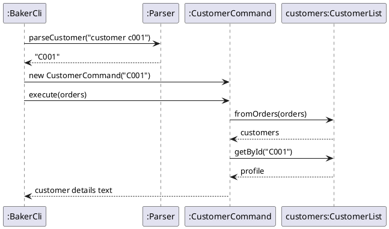

# Developer Guide

## Acknowledgements

{list here sources of all reused/adapted ideas, code, documentation, and third-party libraries -- include links to the original source as well}

## Design & implementation

### Add Order and customer details

This section covers adding an order and recording who it is for (features 1 and 7).
The baker supplies a name, phone number, due date, cake size, flavour, and filling.
One successful command creates a usable order, displays its ID and details, and
requests a save. The integrated flow also reports the Customer ID and warns about
capacity. Customer IDs and capacity checks use the team's shared components;
the customer/history section below explains customer grouping in more detail.

#### Responsibilities

| Component | Responsibility in this flow |
| --- | --- |
| `BakerCli` | Receives `add`, creates the objects, adds the order, and prints the result. |
| `Parser` | Checks the command and returns an `AddOrderDetails` value object. |
| `Customer` | Holds the name and phone recorded for this order. |
| `Cake` | Holds the size, flavour, and filling. |
| `Order` | Combines these details with an ID, due date, and status. |
| `OrderList` | Generates Order IDs, assigns Customer IDs, holds records, and counts active orders by date. |
| `Duke` and `Storage` | Supply the save callback and write the records to disk. |

The class diagram shows only the members relevant to adding an order. Although
older `Order` constructors allow missing cake details, Add Order always supplies
one `Customer` and one `Cake`. Each add creates its own customer object, even if
another order has the same name or phone. These per-order objects keep name edits
independent. Orders with matching phone numbers can share a Customer ID, which
allows the customer/history commands to group them without merging the orders.

#### Validation before changing data

The syntax is `add n/NAME p/PHONE d/DATE s/SIZE f/FLAVOUR fi/FILLING`.
`BakerCli.addOrderAndReportCustomer` validates the input before looking up the
customer. It then calls `addOrder`, which validates the input again before creating
the order. Both calls use `Parser.parseAdd`, which delegates to the shared
six-field parser also used by `enquire`. The parser identifies prefixes and
collects their values, then checks
the required fields and converts the date and size. No order ID is requested
until parsing has finished successfully.

* All six fields must be present and non-blank. Their order may vary.
* Prefixes must be lowercase. Unknown or repeated prefixes are rejected.
* Surrounding whitespace is removed from field values. Internal spaces,
  punctuation, and Unicode characters in customer names are preserved.
* Phone numbers must be non-blank. There is currently no digits-only or
  fixed-length rule; formatted numbers such as `+65 9123-4567` are retained.
* Dates use strict `dd-MM-uuuu` parsing, so impossible dates are rejected.
  The parser accepts past dates; it does not enforce a future-date rule.
* Cake sizes are limited to 6, 8, or 10 inches.

Missing-field messages identify both the field and the syntax needed to fix it.
For example, a blank name produces
`Missing value for n/. Please provide a customer name using n/NAME.`
`BakerCli` catches `CakeQueueException`, prefixes the message with `Error:`, and
continues accepting commands. A failed parse neither consumes an ID nor changes
the in-memory list or the saved file.

Keeping these checks in `Parser` avoids repeating six-field parsing in each CLI.
The parser returns structured details rather than creating an order itself, so
validation can be tested without generating IDs or writing files. A stricter
phone policy would change accepted input and should be agreed by the team before
being added to this shared parser.

#### Creating and saving an order

After successful parsing, `BakerCli.addOrder` requests an Order ID from `OrderList`,
constructs the customer and cake, and creates an `Order` with status `QUEUED`.
`OrderList.add` assigns or reuses a Customer ID by phone number before adding the
record. The existing `Cake` constructor also checks size, flavour, and filling.
The CLI logs the Order ID rather than the customer's name or phone.

The add helper appends a capacity warning when active orders on the due date
exceed the configured limit. It still adds the order. The default limit is 5,
can be changed to 1–50 using `capacity`, and resets on restart. Enquiries and
closed records do not count. The wrapper then appends the Customer ID and whether
the customer is new or returning; it does not generate another order.

The ID counter produces values such as `O001` and `O002`. When `Storage.load`
restores existing records, `OrderList.add` advances the counters past their IDs.
Consequently, the next add continues after the restored IDs instead of starting
again at `O001`. Rejected command input does not advance the counter because
parsing precedes ID generation.

`BakerCli.run` prints the confirmation and invokes its `afterChange` callback.
`Duke` supplies this callback, keeping file handling outside the CLI. `Storage`
writes the full list to a temporary file and then replaces the data file. The
default path is `data/cakequeue.txt`, relative to the application's launch folder.

A successful in-memory add and a successful disk save are separate outcomes.
If saving fails, the order remains available during the current session and
`Duke` displays a warning that the changes are kept for this session only.
The application does not roll back the add. The sequence diagram therefore shows
confirmation before saving, and a separate warning on failure.

#### Regression tests

| Test class | Behaviour checked |
| --- | --- |
| `AddOrderValidationTest` | Guidance for each missing field, blank names, punctuation, Unicode, and formatted phones. |
| `AddOrderReliabilityTest` | Rejected commands preserve saved data and IDs; names survive restarting; customer IDs, enquiries, capacity warnings, and independent name edits work together. |
| `ParserTest` and `ParserErrorTest` | Existing command syntax, date/size validation, unknown prefixes, and duplicate fields. |

CLI tests run against JUnit temporary folders. They restore standard input and
output after each session and never use the baker's real data file. Persistence
tests inspect restored model values as well as CLI messages, so a correct-looking
confirmation alone is not enough to pass.

Diagram sources are in `docs/diagrams/add-order-class.puml` and
`docs/diagrams/add-order-sequence.puml`. Their PNG exports are in `docs/images`.
Update both the source and its export when the implementation changes.

### Customer and history features

#### What they do

- `customer CUSTOMER_ID` shows a customer's ID, name, phone number, number of orders and whether they are a repeat customer.
- `history CUSTOMER_ID` lists every order the customer has placed, including cancelled ones, with each order's status.
- `add` also prints the customer's ID and whether they are new or returning. `view` shows the customer's ID for an order.

Both commands are available in baker mode only.

#### Design

Every confirmed order (ID starting with `O`) carries a **Customer ID** (`C001`, `C002`, ...), stored in `Order#customerId`. The ID is assigned **once**, inside `OrderList#add`, and never changes afterwards:

- A new order takes the Customer ID of the most recent order with the same phone number.
- If no order has that phone number, it takes the next unused ID (`OrderList` keeps a counter, advanced past any ID loaded from disk).
- Editing an order copies its Customer ID (`Order#updatedCopy`), so editing a name or phone number never changes an ID.
- Enquiries (IDs starting with `E`) have no Customer ID until the baker accepts them, because accepting creates a new order through `OrderList#add`.

The Customer ID is saved as an optional 9th field in the data file (`-` when absent). `Storage` still reads older 8-field files, and those orders get IDs by phone number when loaded.

`CustomerList.fromOrders(OrderList)` builds a read-only snapshot by grouping the confirmed orders by Customer ID. A customer's name and phone number are those on their most recent order.

| Class | Responsibility |
|---|---|
| `Order` | Holds the Customer ID (`getCustomerId`, `setCustomerId`) and keeps it when copied by `updatedCopy`. |
| `OrderList` | Assigns the Customer ID when a confirmed order is added (`assignCustomerId`). |
| `Storage` | Saves and loads the Customer ID as an optional 9th field. |
| `CustomerProfile` | Holds one customer's ID, phone number and orders. Gives the name (from their latest order) and whether they are a repeat customer (more than one order). |
| `CustomerList` | Groups orders into `CustomerProfile`s. Looks customers up by ID (`getById`) or phone number (`findByPhone`). |
| `CustomerCommand` | Produces the output of `customer CUSTOMER_ID`. |
| `HistoryCommand` | Produces the output of `history CUSTOMER_ID`. |
| `Parser` | `parseCustomer` and `parseHistory` check the input format and return the upper-cased ID. |
| `BakerCli` | Routes `customer` and `history`, and adds the customer line to the output of `add`. |

#### Sequence of `customer C001`

`history` works the same way, with `HistoryCommand` building a numbered list from `profile.getOrders()` instead.

#### Error handling

| Input | Result |
|---|---|
| `customer` or `customer X1` | `Error: Use: customer CUSTOMER_ID` |
| `history` or `history X1` | `Error: Use: history CUSTOMER_ID` |
| `customer C999` (no such customer) | `Error: Customer not found: C999` |
| A data file line with a malformed Customer ID | The line is skipped with a warning, like any other corrupted line. |

All user errors are `CakeQueueException`s, which `BakerCli` catches and prints, so the program keeps running.

#### Design considerations

**Alternative 1 (chosen): store the Customer ID on each order and save it with the order.**
- Pros: an ID always refers to the same customer, even after a phone number is edited and after a restart. No separate customer file to keep in sync. Old save files still load.
- Cons: changes the data file format (one optional field) and touches `Order`, `OrderList` and `Storage`, which other team members own. Changing the phone number on an order does not move it to another customer.

**Alternative 2: work the IDs out from the order list each time (by order of first appearance of each phone number).**
- Pros: no change to the data file or other classes.
- Cons: rejected after review. Editing the phone number on an order could make an existing ID refer to a different customer.

**Alternative 3: store a separate `CustomerList` in its own file.**
- Pros: IDs would never change.
- Cons: a second file to load and save, which could disagree with the order file.

**Identifying customers by phone number, not name.** Two customers can share a name, and one customer's name can be spelled differently across orders. The rest of the app (`mine`, `track`) already uses the phone number.

#### Manual testing

1. Start the app and enter `baker`.
2. `add n/Alice Tan p/91234567 d/22-12-2026 s/8 f/Chocolate fi/Strawberry`. Expected: `Customer ID: C001 (new customer)`.
3. `add n/Bob Lim p/81234567 d/20-12-2026 s/6 f/Vanilla fi/Cream`. Expected: `Customer ID: C002 (new customer)`.
4. Add Alice again with a different date. Expected: `Customer ID: C001 (returning customer)`.
5. `customer C001`. Expected: `Orders: 2` and `Repeat customer: Yes`.
6. `history C001`. Expected: two orders listed for Alice.
7. `cancel O003`, then `history C001`. Expected: `O003` still listed, marked `[CANCELLED]`.
8. `edit O001 p/90000000`, then `customer C002`. Expected: still Bob Lim (IDs do not change after a phone edit). Then `customer C001`. Expected: still Alice Tan, but the phone shown is `91234567`, because a customer's phone comes from their newest order (`O003`). `view O001` shows the edited phone `90000000`.
9. `customer C999`. Expected: `Error: Customer not found: C999`.
10. `customer` with no ID. Expected: `Error: Use: customer CUSTOMER_ID`.
11. `bye`, restart the app, enter `baker`, then `customer C002`. Expected: Bob's details (IDs are saved).

### View feature

`view ORDER_ID|ENQUIRY_ID` shows the full details of one record. `BakerCli` passes the ID through `Parser.parseView` to `ViewOrderCommand`, which calls `OrderList.getById` and returns `Order.toDetailedString()`. For confirmed orders, it also appends a `Customer ID:` line using `Order#getCustomerId`.

| Input | Result |
|---|---|
| `view` with no ID, or a badly formatted ID | `Error: Use: view ORDER_ID|ENQUIRY_ID` |
| `view O999` (no such record) | `Error: Order not found: O999` |

Manual test: `add` an order, then `view O001`. Expected: the order's details, ending with a `Customer ID: C001` line. Then `view O999`. Expected: the not-found error.

## Product scope
### Target user profile

{Describe the target user profile}

### Value proposition

{Describe the value proposition: what problem does it solve?}

## User Stories

|Version| As a ... | I want to ... | So that I can ...|
|--------|----------|---------------|------------------|
|v1.0|new user|see usage instructions|refer to them when I forget how to use the application|
|v2.0|user|find a to-do item by name|locate a to-do without having to go through the entire list|

## Non-Functional Requirements

{Give non-functional requirements}

## Glossary

* *glossary item* - Definition

## Instructions for manual testing

### Add Order and customer details

Use a fresh folder containing `cakequeue.jar` to avoid changing existing data.
Run `java -ea -jar cakequeue.jar`, then enter `baker` at the mode prompt.
The IDs below assume this folder has no saved records.

1. Add a complete order:
   `add n/Alice Tan p/91234567 d/30-10-2026 s/8 f/Chocolate fi/Strawberry`.
   Expect a confirmation for `O001`, including all six values, `QUEUED`, and
   `Customer ID: C001 (new customer)`.
2. Enter `add p/91234567 d/30-10-2026 s/8 f/Chocolate fi/Strawberry`.
   Expect `Error: Missing value for n/. Please provide a customer name using n/NAME.`
   Enter `view O001`; the original order must remain unchanged.
3. Try an impossible date (`d/31-02-2026`) or unsupported size (`s/7`) in the
   complete command. Expect a date or size error, with no new order added.
4. Add another complete order with `n/Élodie O'Connor-Tan` and
   `p/+65 9123-4567`. Expect `O002`; the name and phone must be preserved.
5. Enter `bye`, relaunch from the same folder, and choose `baker`.
   Use `view O001` and `view O002` to check the saved details. Add one more
   valid order and check that its ID is `O003`.
6. Add two orders with the same name and phone. Edit the name of just one with
   `edit ORDER_ID n/Alicia Tan`, using its actual ID. View both records and
   restart again. Only the selected order should show the new name.
7. Enter `capacity 1`, then add another order with the same due date as an active
   order. Expect a warning and a successful add. Use `view` to confirm the record
   exists, then use `customer C001` and `history C001` to check Alice's grouping.
   Restarting should preserve the records and Customer IDs while resetting
   capacity to 5.

If a save warning appears, the changed records are only guaranteed for the
current session. Keep the application open while checking the destination
folder's write permissions, then make a successful change to retry saving.
