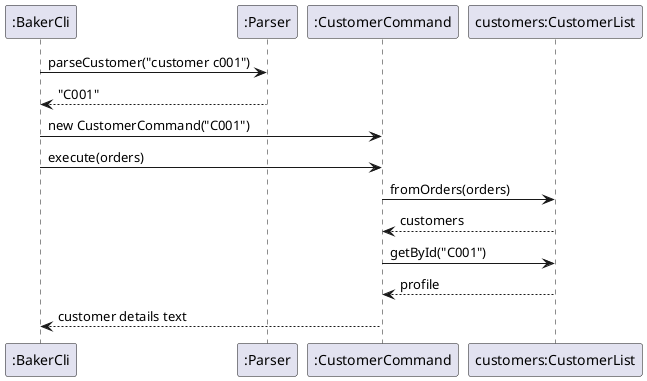

### Customer and history features

#### What they do

- `customer CUSTOMER_ID` shows a customer's ID, name, phone number, number of orders and whether they are a repeat customer.
- `history CUSTOMER_ID` lists every order the customer has placed, including cancelled ones, with each order's status.
- `add` also prints the customer's ID and whether they are new or returning. `view` shows the customer's ID for an order.

Both commands are available in baker mode only.

#### Design

A customer is identified by their **phone number**. Customers are not stored anywhere. Every time a command needs them, `CustomerList.fromOrders(OrderList)` goes through the confirmed orders (IDs starting with `O`) in list order and groups them by phone number. The first phone number to appear becomes `C001`, the next new one `C002`, and so on. Enquiries (IDs starting with `E`) are ignored until the baker accepts them.

| Class | Responsibility |
|---|---|
| `CustomerProfile` | Holds one customer's ID, phone number and orders. Gives the name (from their latest order) and whether they are a repeat customer (more than one order). |
| `CustomerList` | Builds all `CustomerProfile`s from an `OrderList`. Looks customers up by ID (`getById`) or phone number (`findByPhone`). |
| `CustomerCommand` | Produces the output of `customer CUSTOMER_ID`. |
| `HistoryCommand` | Produces the output of `history CUSTOMER_ID`. |
| `Parser` | `parseCustomer` and `parseHistory` check the input format and return the upper-cased ID. |
| `BakerCli` | Routes `customer` and `history`, and adds the customer line to the output of `add`. |

#### Sequence of `customer C001`

`history` works the same way, with `HistoryCommand` building a numbered list from `profile.getOrders()` instead.

#### Error handling

| Input | Result |
|---|---|
| `customer` or `customer X1` | `Error: Use: customer CUSTOMER_ID` |
| `history` or `history X1` | `Error: Use: history CUSTOMER_ID` |
| `customer C999` (no such customer) | `Error: Customer not found: C999` |

All of these are `CakeQueueException`s, which `BakerCli` catches and prints, so the program keeps running.

#### Design considerations

**Alternative 1 (chosen): work customers out from the order list each time.**
- Pros: no change to the save file format, no extra data to keep in sync, and IDs stay the same after the app is restarted.
- Cons: a little extra work on each command, which is not noticeable at this scale. If the phone number on a customer's *first* order is edited, the numbering of later customers can shift.

**Alternative 2: store a `CustomerList` and save it to its own file.**
- Pros: IDs would never change.
- Cons: a second file to load and save, and the two files could disagree with each other. It would also need changes to `Storage` and `Duke`, which belong to other team members.

**Identifying customers by phone number, not by name.** Two different customers can share a name, and one customer's name can be spelled differently across orders. The rest of the app (`mine`, `track`) already uses the phone number to identify customers, so this is consistent.

#### Manual testing

1. Start the app and enter `baker`.
2. `add n/Alice Tan p/91234567 d/22-12-2026 s/8 f/Chocolate fi/Strawberry`. Expected: `Customer ID: C001 (new customer)`.
3. `add n/Bob Lim p/81234567 d/20-12-2026 s/6 f/Vanilla fi/Cream`. Expected: `Customer ID: C002 (new customer)`.
4. Add Alice again with a different date. Expected: `Customer ID: C001 (returning customer)`.
5. `customer C001`. Expected: `Orders: 2` and `Repeat customer: Yes`.
6. `history C001`. Expected: two orders listed for Alice.
7. `cancel O003`, then `history C001`. Expected: `O003` still listed, marked `[CANCELLED]`.
8. `customer C999`. Expected: `Error: Customer not found: C999`.
9. `customer` with no ID. Expected: `Error: Use: customer CUSTOMER_ID`.
10. `bye`, restart the app, enter `baker`, then `customer C002`. Expected: Bob's details (IDs are the same after a restart).

### View feature

`view ORDER_ID|ENQUIRY_ID` shows the full details of one record. `BakerCli` passes the ID through `Parser.parseView` to `ViewOrderCommand`, which calls `OrderList.getById` and returns `Order.toDetailedString()`. For confirmed orders (IDs starting with `O`), it also looks the order's phone number up in `CustomerList` and adds a `Customer ID:` line.

| Input | Result |
|---|---|
| `view` with no ID, or a badly formatted ID | `Error: Use: view ORDER_ID|ENQUIRY_ID` |
| `view O999` (no such record) | `Error: Order not found: O999` |

Manual test: `add` an order, then `view O001`. Expected: the order's details, ending with a `Customer ID: C001` line. Then `view O999`. Expected: the not-found error.