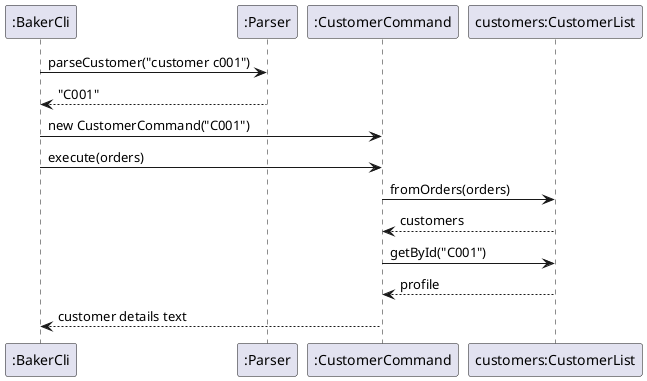

### Customer and history features

#### What they do

- `customer CUSTOMER_ID` shows a customer's ID, name, phone number, number of orders and whether they are a repeat customer.
- `history CUSTOMER_ID` lists every order the customer has placed, including cancelled ones, with each order's status.
- `add` also prints the customer's ID and whether they are new or returning. `view` shows the customer's ID for an order.

Both commands are available in baker mode only.

#### Design

Every confirmed order (ID starting with `O`) carries a **Customer ID** (`C001`, `C002`, ...), stored in `Order#customerId`. The ID is assigned **once**, inside `OrderList#add`, and never changes afterwards:

- A new order takes the Customer ID of the most recent order with the same phone number.
- If no order has that phone number, it takes the next unused ID (`OrderList` keeps a counter, advanced past any ID loaded from disk).
- Editing an order copies its Customer ID (`Order#updatedCopy`), so editing a name or phone number never changes an ID.
- Enquiries (IDs starting with `E`) have no Customer ID until the baker accepts them, because accepting creates a new order through `OrderList#add`.

The Customer ID is saved as an optional 9th field in the data file (`-` when absent). `Storage` still reads older 8-field files, and those orders get IDs by phone number when loaded.

`CustomerList.fromOrders(OrderList)` builds a read-only snapshot by grouping the confirmed orders by Customer ID. A customer's name and phone number are those on their most recent order.

| Class | Responsibility |
|---|---|
| `Order` | Holds the Customer ID (`getCustomerId`, `setCustomerId`) and keeps it when copied by `updatedCopy`. |
| `OrderList` | Assigns the Customer ID when a confirmed order is added (`assignCustomerId`). |
| `Storage` | Saves and loads the Customer ID as an optional 9th field. |
| `CustomerProfile` | Holds one customer's ID, phone number and orders. Gives the name (from their latest order) and whether they are a repeat customer (more than one order). |
| `CustomerList` | Groups orders into `CustomerProfile`s. Looks customers up by ID (`getById`) or phone number (`findByPhone`). |
| `CustomerCommand` | Produces the output of `customer CUSTOMER_ID`. |
| `HistoryCommand` | Produces the output of `history CUSTOMER_ID`. |
| `Parser` | `parseCustomer` and `parseHistory` check the input format and return the upper-cased ID. |
| `BakerCli` | Routes `customer` and `history`, and adds the customer line to the output of `add`. |

#### Sequence of `customer C001`

`history` works the same way, with `HistoryCommand` building a numbered list from `profile.getOrders()` instead.

#### Error handling

| Input | Result |
|---|---|
| `customer` or `customer X1` | `Error: Use: customer CUSTOMER_ID` |
| `history` or `history X1` | `Error: Use: history CUSTOMER_ID` |
| `customer C999` (no such customer) | `Error: Customer not found: C999` |
| A data file line with a malformed Customer ID | The line is skipped with a warning, like any other corrupted line. |

All user errors are `CakeQueueException`s, which `BakerCli` catches and prints, so the program keeps running.

#### Design considerations

**Alternative 1 (chosen): store the Customer ID on each order and save it with the order.**
- Pros: an ID always refers to the same customer, even after a phone number is edited and after a restart. No separate customer file to keep in sync. Old save files still load.
- Cons: changes the data file format (one optional field) and touches `Order`, `OrderList` and `Storage`, which other team members own. Changing the phone number on an order does not move it to another customer.

**Alternative 2: work the IDs out from the order list each time (by order of first appearance of each phone number).**
- Pros: no change to the data file or other classes.
- Cons: rejected after review. Editing the phone number on an order could make an existing ID refer to a different customer.

**Alternative 3: store a separate `CustomerList` in its own file.**
- Pros: IDs would never change.
- Cons: a second file to load and save, which could disagree with the order file.

**Identifying customers by phone number, not name.** Two customers can share a name, and one customer's name can be spelled differently across orders. The rest of the app (`mine`, `track`) already uses the phone number.

#### Manual testing

1. Start the app and enter `baker`.
2. `add n/Alice Tan p/91234567 d/22-12-2026 s/8 f/Chocolate fi/Strawberry`. Expected: `Customer ID: C001 (new customer)`.
3. `add n/Bob Lim p/81234567 d/20-12-2026 s/6 f/Vanilla fi/Cream`. Expected: `Customer ID: C002 (new customer)`.
4. Add Alice again with a different date. Expected: `Customer ID: C001 (returning customer)`.
5. `customer C001`. Expected: `Orders: 2` and `Repeat customer: Yes`.
6. `history C001`. Expected: two orders listed for Alice.
7. `cancel O003`, then `history C001`. Expected: `O003` still listed, marked `[CANCELLED]`.
8. `edit O001 p/90000000`, then `customer C002`. Expected: still Bob Lim (IDs do not change after a phone edit). `customer C001` now shows phone `90000000`.
9. `customer C999`. Expected: `Error: Customer not found: C999`.
10. `customer` with no ID. Expected: `Error: Use: customer CUSTOMER_ID`.
11. `bye`, restart the app, enter `baker`, then `customer C002`. Expected: Bob's details (IDs are saved).

### View feature

`view ORDER_ID|ENQUIRY_ID` shows the full details of one record. `BakerCli` passes the ID through `Parser.parseView` to `ViewOrderCommand`, which calls `OrderList.getById` and returns `Order.toDetailedString()`. For confirmed orders, it also appends a `Customer ID:` line using `Order#getCustomerId`.

| Input | Result |
|---|---|
| `view` with no ID, or a badly formatted ID | `Error: Use: view ORDER_ID|ENQUIRY_ID` |
| `view O999` (no such record) | `Error: Order not found: O999` |

Manual test: `add` an order, then `view O001`. Expected: the order's details, ending with a `Customer ID: C001` line. Then `view O999`. Expected: the not-found error.