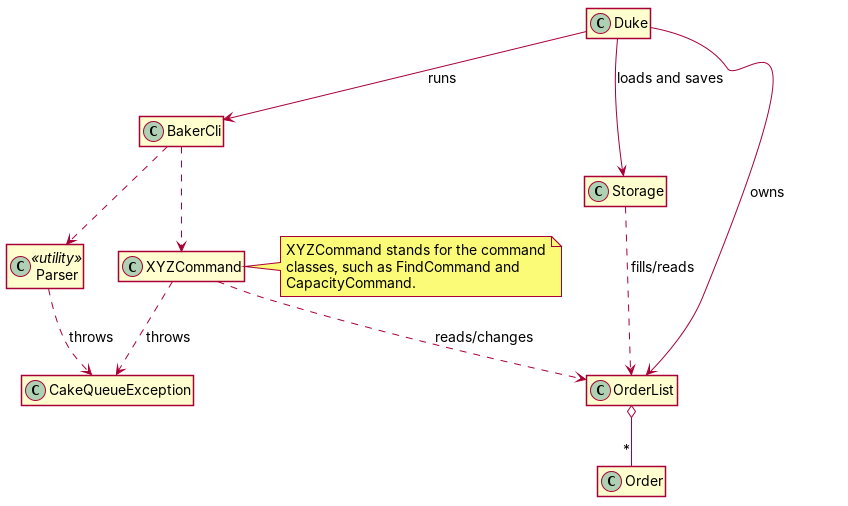
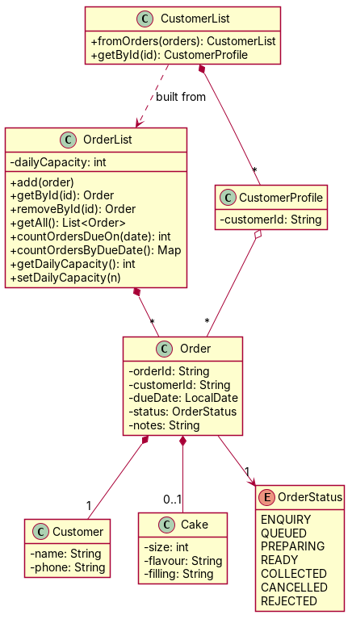
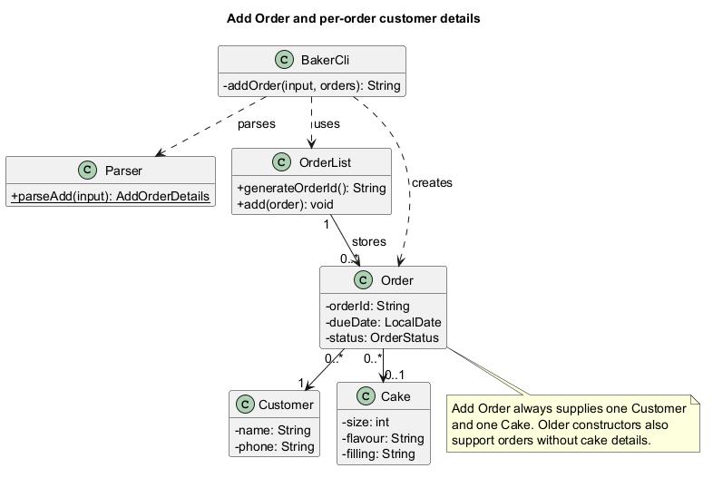
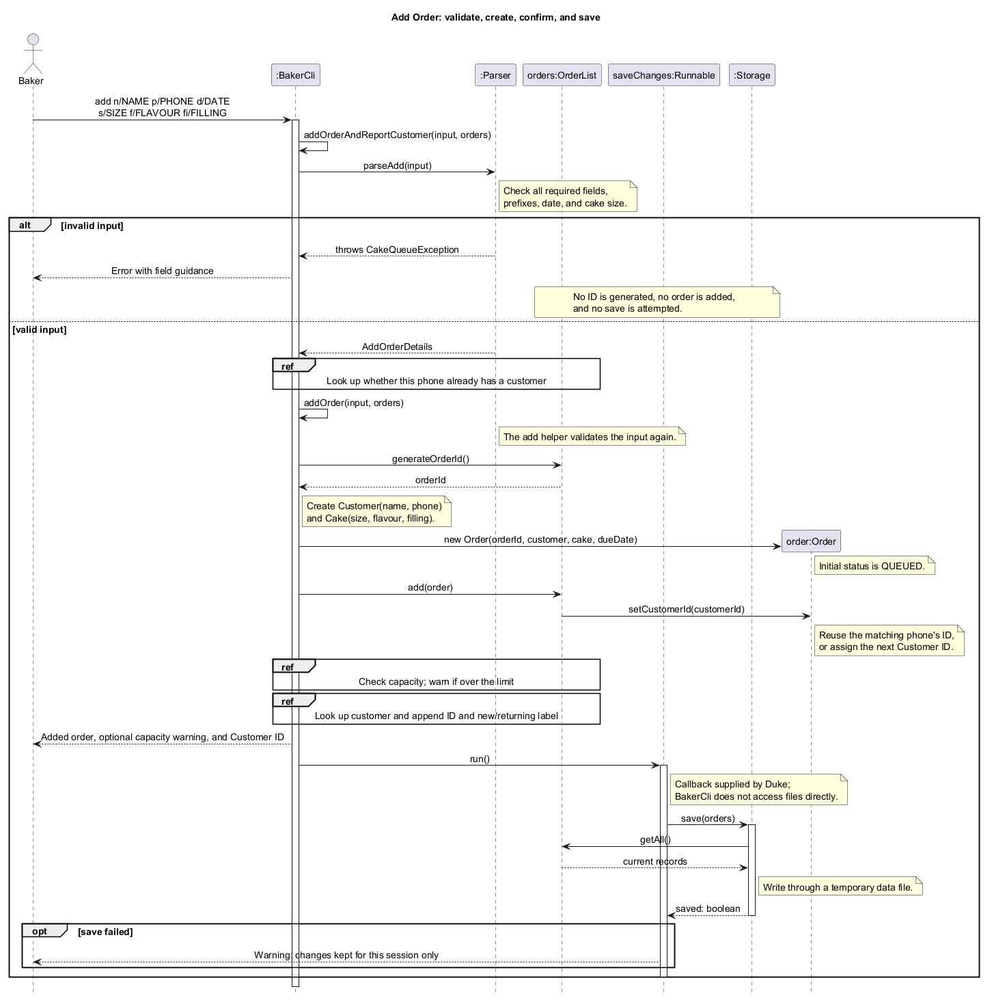
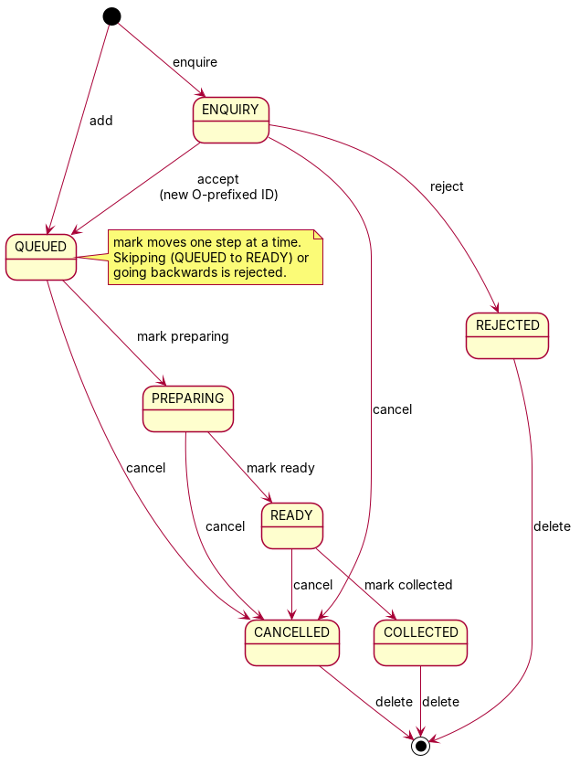
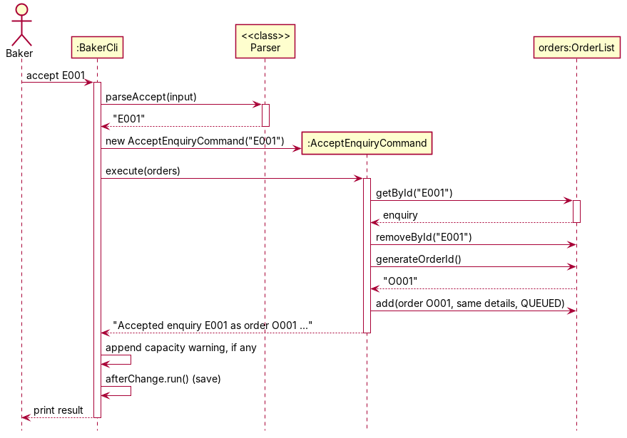
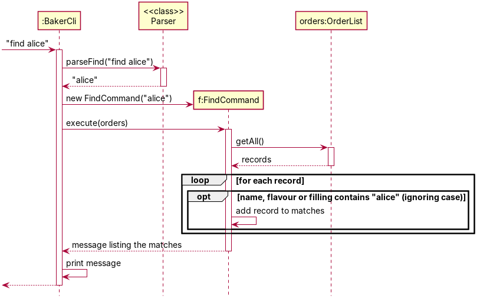
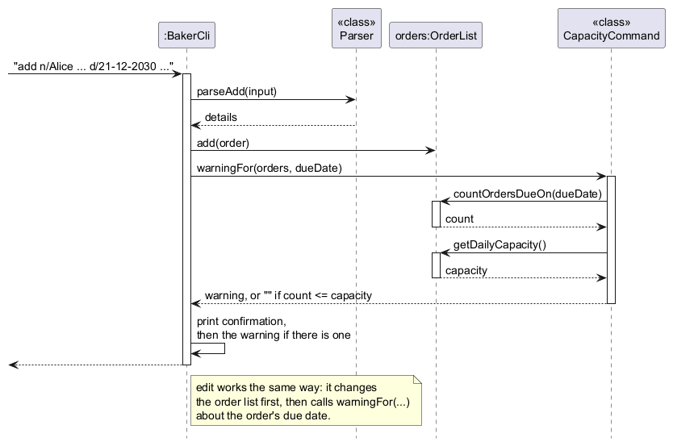
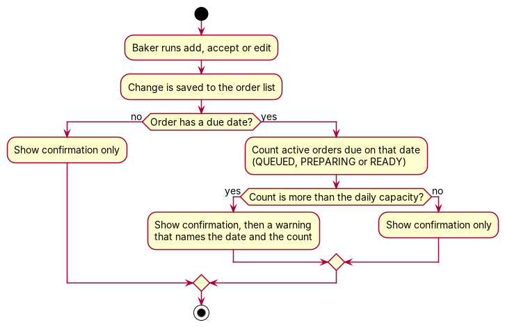
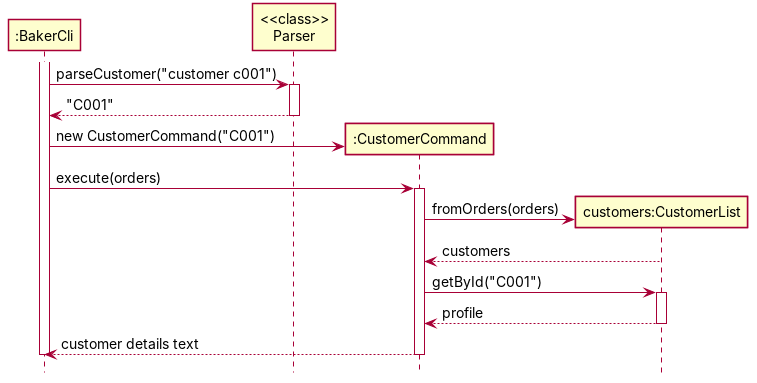

# CakeQueue Developer Guide

CakeQueue is a command-line app that helps home bakers manage custom cake orders. This guide is for
developers who want to understand how it is built or add to it.

## Table of Contents

* [Acknowledgements](#acknowledgements)
* [Setting Up](#setting-up)
* [Design](#design)
    * [Architecture](#architecture)
    * [Parser](#parser)
    * [Commands](#commands)
    * [Model](#model)
    * [Storage](#storage)
    * [Error handling](#error-handling)
* [Implementation](#implementation)
    * [Add Order and customer details](#add-order-and-customer-details)
    * [Enquiries, status marking and storage](#enquiries-status-marking-and-storage)
    * [Find feature](#find-feature)
    * [Daily capacity feature](#daily-capacity-feature)
    * [Customer and history features](#customer-and-history-features)
    * [View feature](#view-feature)
    * [Notes, delete and stats](#notes-delete-and-stats)
* [Appendix A: Product Scope](#appendix-a-product-scope)
* [Appendix B: User Stories](#appendix-b-user-stories)
* [Appendix C: Non-Functional Requirements](#appendix-c-non-functional-requirements)
* [Appendix D: Glossary](#appendix-d-glossary)
* [Appendix E: Instructions for Manual Testing](#appendix-e-instructions-for-manual-testing)

## Acknowledgements

* This project started from the CS2113 team project template, which is why the code keeps the
  `seedu.duke` package name.
* The structure and style of this guide follow the
  [AddressBook-Level3 Developer Guide](https://se-education.org/addressbook-level3/DeveloperGuide.html).
* Diagrams are drawn with [PlantUML](https://plantuml.com). The `.puml` source of each diagram is in
  `docs/diagrams`.
* Tools and libraries: [JUnit 5](https://junit.org/junit5/) for tests, [Gradle](https://gradle.org) with the
  [Shadow plugin](https://gradleup.com/shadow/) to build the JAR, and
  [Checkstyle](https://checkstyle.org) for code style.

## Setting Up

Use JDK 25. Import the project folder as a Gradle project in IntelliJ IDEA, and select Java 25 as the
project SDK and the Gradle JVM. The entry point is `seedu.duke.Duke`. The README lists the Gradle
commands to run, test and build the JAR. `./gradlew check` runs the tests and Checkstyle together, and
it is also what the continuous integration build runs on Windows, macOS and Linux.

## Design

### Architecture

CakeQueue is split into a few small parts that each do one job:

| Part | What it does |
| --- | --- |
| `Duke` | Starts the app. It loads the saved records and runs the `BakerCli` command loop, giving it a *save* callback that is called after every change. |
| `BakerCli` | The command loop. It reads a line, picks the command by its first word, runs it, and prints the result or `Error: ...`. |
| `Parser` | Checks the text of a command and turns it into values such as an ID or a set of fields. |
| `command` package | One class per command, such as `FindCommand` and `CapacityCommand`. A command carries out the work and returns the text to print. |
| `model` package | The data: `OrderList`, `Order`, `Customer`, `Cake`, `OrderStatus`, and the read-only `CustomerList` and `CustomerProfile`. |
| `Storage` | Saves and loads the order list as a text file. |
| `CakeQueueException` | The one exception type for errors the user can fix. |

CakeQueue is used by the baker only. Earlier versions also had a customer mode with its own command loop;
it was removed in v2.0 so that the baker records enquiries directly with `enquire` (see
[Enquiries, status marking and storage](#enquiries-status-marking-and-storage)).

**How a command runs.** A command line goes through these steps:

1. The command loop reads the line and looks at the first word to choose the command.
2. `Parser` checks the rest of the line. If the input is wrong, it throws a `CakeQueueException`.
3. The loop creates the command object with the parsed values and calls `execute(orders)`.
4. The command reads or changes the `OrderList` and returns a message.
5. The loop prints the message. If the command changed anything, it then runs the save callback.

The sequence diagrams in [Find feature](#find-feature) and [Daily capacity feature](#daily-capacity-feature)
show this in detail for two commands.

### Parser

`Parser` is a utility class with only static methods, one per command shape, such as `parseFind`,
`parseCapacity`, `parseView` and `parseAdd`. Field-based commands (`add`, `enquire` and `edit`) use shared
routines that find the `n/`, `p/`, `d/`, `s/`, `f/` and `fi/` prefixes, reject unknown or repeated
prefixes and empty values, and check dates and cake sizes. The parser only checks the *format* of the
input. Checks that need the data, such as whether an order ID exists, are done by the commands.

### Commands

Each command class is small and does one thing. A command is built with its parsed values and has an
`execute(OrderList)` method that returns the text to print, so commands can be tested without any
input or output. Commands do not print or save anything themselves. The command loop does that.

### Model

* `OrderList` is the single list of all records, both enquiries and confirmed orders. It also hands out
  new IDs (`O001` for orders, `E001` for enquiries, `C001` for customers) and keeps the daily capacity.
* `Order` holds the customer, the cake, the due date, the status and free-text notes. Apart from the
  status, the customer ID and the notes, its fields are fixed once the order is created. `edit` builds a changed copy with
  `Order#updatedCopy`.
* `OrderStatus` is `ENQUIRY`, `QUEUED`, `PREPARING`, `READY`, `COLLECTED`, `CANCELLED` or `REJECTED`.
* `CustomerList` and `CustomerProfile` are built fresh from the order list when needed. They are never
  saved, so there is only one copy of the data.

### Storage

`Storage` keeps the order list in `data/cakequeue.txt` as plain text, with one record per line:
`ID | STATUS | NAME | PHONE | DUE | SIZE | FLAVOUR | FILLING | CUSTOMER_ID | NOTES`, where `-` marks an empty
value and `\|` is an escaped `|` inside a value. The customer ID and notes were added in v2.0; lines with 8 or 9
fields from older versions still load. A 9-field line normally ends with a customer ID, but some files were saved
with notes in that position, so a 9th field that does not look like an ID (one letter then digits) is read as
notes, and the record gets a customer ID when it is loaded. Plain text
keeps the file readable, easy to compare in Git, and fixable by hand. Two choices keep the data safe:

* A save writes a temporary file first and then moves it over the real file, so a crash in the middle of
  a save cannot leave half a file.
* A line that cannot be read when loading is skipped with a warning, so one bad line does not stop the
  app or lose the other records.

The daily capacity is not part of the saved data yet. See [Daily capacity feature](#daily-capacity-feature).

### Error handling

Every error the user can fix is thrown as a `CakeQueueException`, either by the parser (bad input) or by a
command (for example, an unknown ID or a step that is not allowed). The command loops catch it, print
`Error: <message>`, and carry on. A mistake never ends the session and never changes the data. The
message says what is wrong and, where it helps, shows the correct format, such as `Use: find KEYWORD`.

## Implementation

### Add Order and customer details

This section covers adding an order and recording who it is for (features 1 and 7).
The baker supplies a name, phone number, due date, cake size, flavour, and filling.
One successful command creates a usable order, displays its ID and details, and
requests a save. The integrated flow also reports the Customer ID and warns about
capacity. Customer IDs and capacity checks use the team's shared components;
the customer/history section below explains customer grouping in more detail.

#### Responsibilities

| Component | Responsibility in this flow |
| --- | --- |
| `BakerCli` | Receives `add`, creates the objects, adds the order, and prints the result. |
| `Parser` | Checks the command and returns an `AddOrderDetails` value object. |
| `Customer` | Holds the name and phone recorded for this order. |
| `Cake` | Holds the size, flavour, and filling. |
| `Order` | Combines these details with an ID, due date, and status. |
| `OrderList` | Generates Order IDs, assigns Customer IDs, holds records, and counts active orders by date. |
| `Duke` and `Storage` | Supply the save callback and write the records to disk. |

The class diagram shows only the members relevant to adding an order. Although
older `Order` constructors allow missing cake details, Add Order always supplies
one `Customer` and one `Cake`. Each add creates its own customer object, even if
another order has the same name or phone. These per-order objects keep name edits
independent. Orders with matching phone numbers can share a Customer ID, which
allows the customer/history commands to group them without merging the orders.

#### Validation before changing data

The syntax is `add n/NAME p/PHONE d/DATE s/SIZE f/FLAVOUR fi/FILLING`.
`BakerCli.addOrderAndReportCustomer` validates the input before looking up the
customer. It then calls `addOrder`, which validates the input again before creating
the order. Both calls use `Parser.parseAdd`, which delegates to the shared
six-field parser also used by `enquire`. The parser identifies prefixes and
collects their values, then checks
the required fields and converts the date and size. No order ID is requested
until parsing has finished successfully.

* All six fields must be present and non-blank. Their order may vary.
* Prefixes must be lowercase. Unknown or repeated prefixes are rejected.
* Surrounding whitespace is removed from field values. Internal spaces,
  punctuation, and Unicode characters in customer names are preserved.
* Phone numbers must have at least 8 digits, and may also contain spaces, `+`
  and `-`, so formatted numbers such as `+65 9123-4567` are retained.
* Dates use strict `dd-MM-uuuu` parsing, so impossible dates are rejected.
  Dates before today are rejected. `edit` applies the same date and phone rules.
* Cake sizes are limited to 6, 8, or 10 inches.

Missing-field messages identify both the field and the syntax needed to fix it.
For example, a blank name produces
`Missing value for n/. Please provide a customer name using n/NAME.`
`BakerCli` catches `CakeQueueException`, prefixes the message with `Error:`, and
continues accepting commands. A failed parse neither consumes an ID nor changes
the in-memory list or the saved file.

Keeping these checks in `Parser` avoids repeating six-field parsing in each CLI.
The parser returns structured details rather than creating an order itself, so
validation can be tested without generating IDs or writing files. A stricter
phone policy would change accepted input and should be agreed by the team before
being added to this shared parser.

#### Creating and saving an order

After successful parsing, `BakerCli.addOrder` requests an Order ID from `OrderList`,
constructs the customer and cake, and creates an `Order` with status `QUEUED`.
`OrderList.add` assigns or reuses a Customer ID by phone number before adding the
record. The existing `Cake` constructor also checks size, flavour, and filling.
The CLI logs the Order ID rather than the customer's name or phone.

The add helper appends a capacity warning when active orders on the due date
exceed the configured limit. It still adds the order. The default limit is 5,
can be changed to 1–50 using `capacity`, and resets on restart. Enquiries and
closed records do not count. The wrapper then appends the Customer ID and whether
the customer is new or returning; it does not generate another order.

The ID counter produces values such as `O001` and `O002`. When `Storage.load`
restores existing records, `OrderList.add` advances the counters past their IDs.
Consequently, the next add continues after the restored IDs instead of starting
again at `O001`. Rejected command input does not advance the counter because
parsing precedes ID generation.

`BakerCli.run` prints the confirmation and invokes its `afterChange` callback.
`Duke` supplies this callback, keeping file handling outside the CLI. `Storage`
writes the full list to a temporary file and then replaces the data file. The
default path is `data/cakequeue.txt`, relative to the application's launch folder.

A successful in-memory add and a successful disk save are separate outcomes.
If saving fails, the order remains available during the current session and
`Duke` displays a warning that the changes are kept for this session only.
The application does not roll back the add. The sequence diagram therefore shows
confirmation before saving, and a separate warning on failure.

#### Regression tests

| Test class | Behaviour checked |
| --- | --- |
| `AddOrderValidationTest` | Guidance for each missing field, blank names, punctuation, Unicode, and formatted phones. |
| `AddOrderReliabilityTest` | Rejected commands preserve saved data and IDs; names survive restarting; customer IDs, enquiries, capacity warnings, and independent name edits work together. |
| `ParserTest` and `ParserErrorTest` | Existing command syntax, date/size validation, unknown prefixes, and duplicate fields. |

CLI tests run against JUnit temporary folders. They restore standard input and
output after each session and never use the baker's real data file. Persistence
tests inspect restored model values as well as CLI messages, so a correct-looking
confirmation alone is not enough to pass.

Diagram sources are in `docs/diagrams/add-order-class.puml` and
`docs/diagrams/add-order-sequence.puml`. Their PNG exports are in `docs/images`.
Update both the source and its export when the implementation changes.

### Enquiries, status marking and storage

<!-- Adapted from Gitanjali's (HammerHead-os) section after customer mode was removed in v2.0. -->

#### Record lifecycle

One `Order` class represents both an enquiry (status `ENQUIRY`, ID starting with `E`) and a confirmed order (ID
starting with `O`). The state diagram shows every status a record can have and the command that moves it on.

#### Enquiry workflow

`enquire` uses the same six-field format and the same parser routine as `add`, so both commands accept and reject
exactly the same input. `EnquireCommand` creates an `Order` with an `E`-prefixed ID and status `ENQUIRY`. The baker
reviews pending enquiries with `enquiries`, then either `reject`s one (status `REJECTED`, record kept) or
`accept`s it:

`AcceptEnquiryCommand` removes the `E` record and adds a new `O` record in `QUEUED` with the same customer, cake,
date and notes. `OrderList#add` then gives it a Customer ID, and `BakerCli` checks the daily capacity for its due date.

*Why accept creates a new ID instead of renaming `E001` to `O001`.* IDs are `final` in `Order`. Creating a new ID
keeps IDs immutable, which `getById` and `Storage` rely on, and the reply ("accepted `E001` as `O001`") makes the
link clear.

*Why customer mode was removed.* v1 had a separate customer command loop in which customers sent and tracked their
own enquiries, proving ownership with their phone number. The team removed it in v2.0. A phone number is weak
proof of identity, and two command loops sharing one terminal did not match how a home baker actually works:
customers send requests by message, and the baker types them in. Recording enquiries with `enquire` keeps the
useful part (requests that are not yet agreed do not count as orders or towards capacity) with one command loop.

#### Production status marking (`mark`)

`mark ORDER_ID preparing|ready|collected` moves a confirmed order exactly one step forward. `Parser.parseMark`
checks the *shape* (an `O` ID and one of the three words), while `MarkCommand` checks the *transition* against the
order's current status. Skipping a step, repeating one, or marking an enquiry or a closed record is rejected with a
message naming the allowed path, and the status is left unchanged. `COLLECTED` records disappear from `list`
because `ListCommand` excludes them.

*Alternative considered:* a `done` command that jumps straight to `COLLECTED` is simpler, but the baker would lose
the difference between "in the oven" and "waiting for pickup", which is the point of tracking status.

#### Saving after every change

`Duke` owns a `Storage` bound to a `Path` (default `data/cakequeue.txt`; tests pass a temporary path). At startup,
`Duke` loads the file into the `OrderList`. After every successful command that changes data, `BakerCli` runs an
`afterChange` callback supplied by `Duke`, which saves. Passing a callback instead of giving `BakerCli` a `Storage`
keeps the command loop unaware of files, and keeps the "warn the user if saving failed" rule in one place.

*Alternative considered:* saving only on `bye` means less file writing, but any crash or closed terminal would lose
the whole session.

When records are loaded, `OrderList#add` moves the next-ID counters past every loaded ID, so a new record never gets
an ID that is already in use.

### Find feature

#### What it does

`find KEYWORD` shows every order and enquiry whose customer name, cake flavour or cake filling contains
the keyword. The match ignores case and may be part of a word.

#### How it works

1. `BakerCli` sees the command word `find` and calls `Parser.parseFind(input)`. The parser rejects a
   missing keyword with `Use: find KEYWORD` and returns the rest of the line, trimmed, as one phrase.
2. `BakerCli` creates a `FindCommand` with the keyword and calls `execute(orders)`.
3. `FindCommand` goes through `orders.getAll()`. For each record it lower-cases the name, flavour and
   filling (using `Locale.ROOT`, so the result does not depend on the user's language settings) and checks
   whether any of them contains the lower-cased keyword. A record with no cake details is matched on the
   name only.
4. It returns the matches as a numbered list, in the order the records were added, or
   `No orders found matching "KEYWORD".`
5. `BakerCli` prints the message. `find` changes nothing, so nothing is saved.

#### Design considerations

**Which fields to search.**

* *Alternative 1 (chosen): customer name, flavour and filling.* Pros: covers the ways a baker actually
  looks for an order ("Alice's order", "the chocolate ones"). Cons: it does not search phone numbers or
  dates. A customer's orders can be listed with `history`, and `list` is ordered by date.
* *Alternative 2: customer name only.* Pros: simpler. Cons: the baker cannot find all orders for a flavour,
  for example when they need to buy more of an ingredient.

**How to treat a keyword that has several words.**

* *Alternative 1 (chosen): one phrase.* `find Alice Tan` matches `Alice Tan` only. Pros: simple to explain
  and predictable, and a longer phrase narrows the result.
* *Alternative 2: match any of the words.* Pros: finds more records. Cons: a longer search finds *more*
  results instead of fewer, which surprises users. It also needs rules for ordering the results.

**Which records to search.** `find` searches all records, including enquiries and orders that are
collected or cancelled, and shows each record's status. Pros: it can find an old order, which `list` hides.
Cons: results can include records the baker no longer cares about, but the status makes them easy to skip.

### Daily capacity feature

#### What it does

A home baker can only make so many cakes in a day. `capacity NUMBER` sets the most active orders the baker
can take for one due date (1 to 50, default 5), and `capacity` shows the limit and any due dates already
over it. When `add`, `accept` or `edit` leaves a due date over the limit, the baker is warned. The change is
still saved.

#### How it works

*Setting and showing the capacity.*

1. `Parser.parseCapacity` returns the new number, or `null` for a bare `capacity`. It throws
   `Daily capacity must be a whole number from 1 to 50.` for a number out of range or not a number, and
   `Use: capacity [NUMBER]` for extra words.
2. `CapacityCommand` calls `orders.setDailyCapacity(n)` when it got a number. `OrderList` checks the range
   again and keeps the old value if it fails.
3. It then asks `orders.countOrdersByDueDate()` for the number of active orders on each date, and lists the
   dates with more orders than the capacity.

*Warning after a change.*

1. `add`, `accept` and `edit` run exactly as before. After the order list has changed, `BakerCli` calls
   `CapacityCommand.warningFor(orders, dueDate)` with the due date of the order that was added, accepted
   or edited. For `edit`, it reads the due date back from the order list, because the command may not have
   changed it.
2. `warningFor` returns an empty string if the order has no due date, or if
   `orders.countOrdersDueOn(dueDate)` is not more than `orders.getDailyCapacity()`. Otherwise, it returns
   the warning text with the date and the count.
3. `BakerCli` appends the warning on a new line after the normal message.

An *active* order is one with status `QUEUED`, `PREPARING` or `READY`. Enquiries do not count, because the
baker has not agreed to them yet. Collected orders do not count, because the work is done. Cancelled and
rejected records do not count, because no work is needed.

#### Design considerations

**Warn or refuse an order that goes over capacity?**

* *Alternative 1 (chosen): warn and still save.* Pros: the baker decides. A baker may take a big order on a
  busy day (a family member helps, or an old customer asks), and a hard refusal would force them to raise the
  limit first. Cons: the baker could ignore the warning.
* *Alternative 2: refuse the order.* Pros: it enforces the limit. Cons: it gets in the way of a normal
  business decision, and `accept` would leave a customer's enquiry stuck.

**Where to keep the capacity.**

* *Alternative 1 (chosen): in `OrderList`.* Pros: the order list is already passed to every command, so no
  command signatures change, and the counting code sits next to the data it counts. Cons: `OrderList` now
  has a small setting in it.
* *Alternative 2: a separate `Settings` class.* Pros: cleaner separation. Cons: every command loop and
  command would need a new argument, which is a larger change for one number.

**What to count.** *Orders per date* is used instead of baking hours per date. Pros: easy for the baker to
understand and to set, with no need to estimate the time of each cake. Cons: a wedding cake and a cupcake
count the same.

**Not saved between runs (current limitation).** `Storage` writes one order per line, so saving the capacity
would change the file format, which the whole team depends on. The capacity therefore goes back to 5 on each
start. The user guide lists this under Current Limitations.

*Proposed implementation.* Write the capacity as a first line such as `#capacity 3` in the data file. Make
`Storage.load` read that line and call `setDailyCapacity`, and make it skip other lines that start with `#`
instead of treating them as corrupted. Older files without the line keep working with the default of 5.

### Customer and history features

#### What they do

- `customer CUSTOMER_ID` shows a customer's ID, name, phone number, number of orders and whether they are a repeat customer.
- `history CUSTOMER_ID` lists every order the customer has placed, including cancelled ones, with each order's status.
- `add` also prints the customer's ID and whether they are new or returning. `view` shows the customer's ID for an order.

#### Design

Every confirmed order (ID starting with `O`) carries a **Customer ID** (`C001`, `C002`, ...), stored in `Order#customerId`. The ID is assigned **once**, inside `OrderList#add`, and never changes afterwards:

- A new order takes the Customer ID of the most recent order with the same phone number.
- If no order has that phone number, it takes the next unused ID (`OrderList` keeps a counter, advanced past any ID loaded from disk).
- Editing an order copies its Customer ID (`Order#updatedCopy`), so editing a name or phone number never changes an ID.
- Enquiries (IDs starting with `E`) have no Customer ID until the baker accepts them, because accepting creates a new order through `OrderList#add`.

The Customer ID is saved as the 9th field in the data file (`-` when absent). `Storage` still reads older 8-field files, and those orders get IDs by phone number when loaded.

`CustomerList.fromOrders(OrderList)` builds a read-only snapshot by grouping the confirmed orders by Customer ID. A customer's name and phone number are those on their most recent order.

| Class | Responsibility |
|---|---|
| `Order` | Holds the Customer ID (`getCustomerId`, `setCustomerId`) and keeps it when copied by `updatedCopy`. |
| `OrderList` | Assigns the Customer ID when a confirmed order is added (`assignCustomerId`). |
| `Storage` | Saves and loads the Customer ID as the 9th field. |
| `CustomerProfile` | Holds one customer's ID, phone number and orders. Gives the name (from their latest order) and whether they are a repeat customer (more than one order). |
| `CustomerList` | Groups orders into `CustomerProfile`s. Looks customers up by ID (`getById`) or phone number (`findByPhone`). |
| `CustomerCommand` | Produces the output of `customer CUSTOMER_ID`. |
| `HistoryCommand` | Produces the output of `history CUSTOMER_ID`. |
| `Parser` | `parseCustomer` and `parseHistory` check the input format and return the upper-cased ID. |
| `BakerCli` | Routes `customer` and `history`, and adds the customer line to the output of `add`. |

#### Sequence of `customer C001`

`history` works the same way, with `HistoryCommand` building a numbered list from `profile.getOrders()` instead.

#### Error handling

| Input | Result |
|---|---|
| `customer` or `customer X1` | `Error: Use: customer CUSTOMER_ID` |
| `history` or `history X1` | `Error: Use: history CUSTOMER_ID` |
| `customer C999` (no such customer) | `Error: Customer not found: C999` |
| A data file line with a malformed Customer ID | The line is skipped with a warning, like any other corrupted line. |

All user errors are `CakeQueueException`s, which `BakerCli` catches and prints, so the program keeps running.

#### Design considerations

**Alternative 1 (chosen): store the Customer ID on each order and save it with the order.**
- Pros: an ID always refers to the same customer, even after a phone number is edited and after a restart. No separate customer file to keep in sync. Old save files still load.
- Cons: changes the data file format (one optional field) and touches `Order`, `OrderList` and `Storage`, which other team members own. Changing the phone number on an order does not move it to another customer.

**Alternative 2: work the IDs out from the order list each time (by order of first appearance of each phone number).**
- Pros: no change to the data file or other classes.
- Cons: rejected after review. Editing the phone number on an order could make an existing ID refer to a different customer.

**Alternative 3: store a separate `CustomerList` in its own file.**
- Pros: IDs would never change.
- Cons: a second file to load and save, which could disagree with the order file.

**Identifying customers by phone number, not name.** Two customers can share a name, and one customer's name can be spelled differently across orders. The phone number is also what the baker usually has when a customer calls.

#### Manual testing

1. Start the app in an empty folder.
2. `add n/Alice Tan p/91234567 d/22-12-2026 s/8 f/Chocolate fi/Strawberry`. Expected: `Customer ID: C001 (new customer)`.
3. `add n/Bob Lim p/81234567 d/20-12-2026 s/6 f/Vanilla fi/Cream`. Expected: `Customer ID: C002 (new customer)`.
4. Add Alice again with a different date. Expected: `Customer ID: C001 (returning customer)`.
5. `customer C001`. Expected: `Orders: 2` and `Repeat customer: Yes`.
6. `history C001`. Expected: two orders listed for Alice.
7. `cancel O003`, then `history C001`. Expected: `O003` still listed, marked `[CANCELLED]`.
8. `edit O001 p/90000000`, then `customer C002`. Expected: still Bob Lim (IDs do not change after a phone edit). Then `customer C001`. Expected: still Alice Tan, but the phone shown is `91234567`, because a customer's phone comes from their newest order (`O003`). `view O001` shows the edited phone `90000000`.
9. `customer C999`. Expected: `Error: Customer not found: C999`.
10. `customer` with no ID. Expected: `Error: Use: customer CUSTOMER_ID`.
11. `bye`, restart the app, then `customer C002`. Expected: Bob's details (IDs are saved).

### View feature

`view ORDER_ID|ENQUIRY_ID` shows the full details of one record. `BakerCli` passes the ID through `Parser.parseView` to `ViewOrderCommand`, which calls `OrderList.getById` and returns `Order.toDetailedString()`. For confirmed orders, it also appends a `Customer ID:` line using `Order#getCustomerId`.

| Input | Result |
|---|---|
| `view` with no ID, or a badly formatted ID | `Error: Use: view ORDER_ID|ENQUIRY_ID` |
| `view O999` (no such record) | `Error: Order not found: O999` |

Manual test: `add` an order, then `view O001`. Expected: the order's details, ending with a `Customer ID: C001` line. Then `view O999`. Expected: the not-found error.

### Notes, delete and stats

<!-- Commands added by Gitanjali (HammerHead-os) in v2.0. -->

These three baker commands each have one command class and one parser method, following the same pattern as the
other commands.

| Command | Class | How it works |
| --- | --- | --- |
| `note ID TEXT` / `note ID -clear` | `NoteCommand` | Looks the record up with `getById` and calls `Order#setNotes`. `-clear` sets an empty string. `Order#updatedCopy` copies the notes, so `edit` keeps them. |
| `delete ID` | `DeleteCommand` | Allows deleting only `CANCELLED`, `REJECTED` or `COLLECTED` records, then calls `OrderList#removeById`. |
| `stats` | `StatsCommand` | Counts records by status and finds the earliest due date among active orders. Read-only. |

**Design considerations.**

* *Notes are stored on `Order` as a plain string, saved as the last field in the data file.* Pros: no new class,
  and older data files without notes still load (they get an empty note). Cons: one note per record; a history of
  notes would need a list.
* *`delete` only removes closed records.* An active order cannot be lost by one mistyped command; the baker must
  `cancel` it first. Cancelled records otherwise stay in `history`, which is why deleting is offered at all.

**Known limitation.** After a restart, `OrderList` continues IDs from the highest ID it loads. If the newest record
was deleted, its ID can be given out again. *Proposed fix:* save the next-ID counters in the data file, the same way
as the [proposed capacity setting](#daily-capacity-feature).

## Appendix A: Product Scope

**Target user profile**

* A home baker who takes custom cake orders as a side business, working alone from home
* Receives orders through chat apps or phone calls, and has to remember what each cake involves
* Needs to know what is due when, and cannot make more than a few cakes in a day
* Is comfortable typing short commands on a laptop, and prefers that to a heavy app

**Value proposition**

CakeQueue keeps track of upcoming custom orders and what each one involves, so the baker knows what is due
when and does not accept more work for a day than they can actually deliver. Enquiries are kept apart from confirmed
orders, so the baker does not have to manage everything in separate chat threads.

**Out of scope.** CakeQueue does not handle payments, ingredient stock, recipes or online ordering by customers.

## Appendix B: User Stories

Priorities: High (must have), Medium (nice to have), Low (unlikely to have).

| Version | Priority | As a ... | I want to ... | So that I can ... |
| --- | --- | --- | --- | --- |
| v1.0 | High | new user | see usage instructions | refer to them when I forget how to use the application |
| v1.0 | High | baker | add an order with the customer, due date and cake details | keep a record of every cake I have promised |
| v1.0 | High | baker | list my upcoming orders, earliest first | see what I need to bake next |
| v1.0 | High | baker | view all the details of one order | check the cake before I start baking |
| v1.0 | Medium | baker | edit an order | handle a change request without entering the order again |
| v2.0 | High | baker | set a daily capacity and be warned when a date goes over it | avoid accepting more cakes than I can deliver in a day |
| v2.0 | Medium | baker | see which dates are over capacity | ask customers to move their dates or arrange extra help |
| v2.0 | High | baker | mark an order as preparing, ready or collected | know which cakes are in progress and which are done |
| v2.0 | Medium | baker | cancel an order or enquiry and keep the record | keep my list accurate and still look back at it |
| v2.0 | Medium | baker | find orders by customer name, flavour or filling | locate an order without going through the whole list |
| v2.0 | High | baker | record a customer's enquiry before agreeing to it | keep requests I have not accepted yet apart from real orders |
| v2.0 | High | baker | accept or reject an enquiry | turn it into an order or turn it down |
| v2.0 | Medium | baker | add notes such as allergies to an order | remember special requests when I bake |
| v2.0 | Low | baker | delete records that are closed | keep my data file tidy |
| v2.0 | Low | baker | see a summary of my queue | know at a glance how busy I am |
| v2.0 | Medium | baker | see a customer's order history | recognise a returning customer and recall their past cakes |
| v2.0 | High | baker | have my orders saved automatically | close the app without losing orders |
| v2.1 | Low | baker | have my daily capacity remembered between sessions | avoid setting it again each time I start the app |

## Appendix C: Non-Functional Requirements

1. **Platform.** CakeQueue should work on Windows, macOS and Linux when Java 25 is the only Java version installed.
2. **Performance.** With up to 1,000 orders, each command should respond within 1 second on an ordinary laptop.
   A check with 1,000 orders (including saving after every change) finished in under 2 seconds for the whole session.
3. **Data safety.** After any command that changes data, the change should already be on disk, so closing the app or
   a crash does not lose it. A damaged line in the data file should not stop the app from starting, and should not
   affect the other records.
4. **Readable data.** The data file should be plain text that a user can open, read and fix in a text editor.
5. **Error messages.** Every invalid command should show a message that says what is wrong, and should not end the
   session or change any data.
6. **Single user.** CakeQueue is used by one person at a time on one computer. It does not need a network connection.
7. **Code quality.** All code and tests should pass Checkstyle, and all tests should pass on Windows, macOS and Linux in
   the continuous integration build before a pull request is merged.

## Appendix D: Glossary

* **Baker** - The person who makes the cakes and uses CakeQueue.
* **Customer** - A person who orders cakes. The baker records their orders and enquiries.
* **Enquiry** - A cake request from a customer that the baker has not answered yet. Its ID starts with `E`.
* **Order** - A confirmed cake request. Its ID starts with `O`.
* **Active order** - An order that is `QUEUED`, `PREPARING` or `READY`. Only these count towards the daily capacity.
* **Daily capacity** - The most active orders the baker is willing to take for one due date.
* **Customer ID** - An ID such as `C001` that identifies one customer by phone number.
* **Mainstream OS** - Windows, Linux and macOS.

## Appendix E: Instructions for Manual Testing

These steps give a path through the main features. The user guide describes each command in detail, so this appendix
only lists inputs to copy and what to expect. The steps use dates in December 2026. If you run them after those dates,
use later dates, because the app rejects due dates in the past.

**Before you start.** Build the JAR with `./gradlew shadowJar`. Copy `build/libs/cakequeue.jar` into a new empty
folder, open a terminal there and run `java -ea -jar cakequeue.jar`. A `data` folder appears in that folder after the
first change.

### Add Order and customer details

Use a fresh folder containing `cakequeue.jar` to avoid changing existing data.
Run `java -ea -jar cakequeue.jar`.
The IDs below assume this folder has no saved records.

1. Add a complete order:
   `add n/Alice Tan p/91234567 d/30-12-2026 s/8 f/Chocolate fi/Strawberry`.
   Expect a confirmation for `O001`, including all six values, `QUEUED`, and
   `Customer ID: C001 (new customer)`.
2. Enter `add p/91234567 d/30-12-2026 s/8 f/Chocolate fi/Strawberry`.
   Expect `Error: Missing value for n/. Please provide a customer name using n/NAME.`
   Enter `view O001`; the original order must remain unchanged.
3. Try an impossible date (`d/31-02-2026`) or unsupported size (`s/7`) in the
   complete command. Expect a date or size error, with no new order added.
4. Add another complete order with `n/Élodie O'Connor-Tan` and
   `p/+65 9123-4567`. Expect `O002`; the name and phone must be preserved.
5. Enter `bye` and relaunch from the same folder.
   Use `view O001` and `view O002` to check the saved details. Add one more
   valid order and check that its ID is `O003`.
6. Add two orders with the same name and phone. Edit the name of just one with
   `edit ORDER_ID n/Alicia Tan`, using its actual ID. View both records and
   restart again. Only the selected order should show the new name.
7. Enter `capacity 1`, then add another order with the same due date as an active
   order. Expect a warning and a successful add. Use `view` to confirm the record
   exists, then use `customer C001` and `history C001` to check Alice's grouping.
   Restarting should preserve the records and Customer IDs while resetting
   capacity to 5.

If a save warning appears, the changed records are only guaranteed for the
current session. Keep the application open while checking the destination
folder's write permissions, then make a successful change to retry saving.

### Starting the app

1. Start the app. Expected: `Hello! I'm CakeQueue.` and `Baker mode. Type help to see commands.`
2. Type `hello`. Expected: `Error: Unknown baker command: hello. Type help to see baker commands.`

### Orders, capacity and progress

1. `add n/Alice Tan p/91234567 d/21-12-2026 s/8 f/Chocolate fi/Strawberry`
   Expected: `Added order O001: ...` followed by `Customer ID: C001 (new customer)`, and no warning.
2. `capacity 1`. Expected: `Daily capacity set to 1 order per day.`
3. `add n/Bob Lim p/81234567 d/21-12-2026 s/6 f/Vanilla fi/Cream`
   Expected: `Warning: 21-12-2026 now has 2 orders, over your daily capacity of 1.` The order is still added.
4. `capacity`. Expected: the capacity, then `These dates are over capacity:` with `21-12-2026: 2 orders`.
5. `mark O001 collected`. Expected: `Error: Cannot change order O001 from QUEUED to COLLECTED. ...`
6. `mark O001 preparing`, then `mark O001 ready`, then `mark O001 collected`. Expected: each reply ends with the new status.
7. `capacity`. Expected: no list of over-capacity dates, because the collected order no longer counts.
8. `capacity 0`, then `capacity abc`. Expected: `Error: Daily capacity must be a whole number from 1 to 50.`, and the capacity stays at 1.

### Enquiries

1. `enquire n/Cara p/92222222 d/22-12-2026 s/10 f/Mocha fi/Cream`.
   Expected: `Submitted enquiry E001: ...`
2. `enquire n/Dan p/9222 d/22-12-2026 s/10 f/Mocha fi/Cream`. Expected: an error saying the phone needs at
   least 8 digits, and no enquiry is added.
3. `enquiries`. Expected: E001 is listed. `capacity` still lists no over-capacity dates for 22-12-2026,
   because enquiries do not count.
4. `accept E001`. Expected: `Accepted enquiry E001 as order O003: ...`, and no `E001` in `enquiries` afterwards.

### Notes, delete and stats

1. `note O003 No nuts`, then `view O003`. Expected: the details end with `Notes: No nuts` and `Customer ID: C003`.
2. `delete O003`. Expected: an error, because only cancelled, rejected or collected records can be deleted.
3. `stats`. Expected: a summary with 2 active orders and 1 collected order.

### Searching and customers

1. `find CHOC`. Expected: `Orders matching "CHOC":` with O001 (matches the flavour, ignoring case).
2. `find cara`. Expected: O003 only.
3. `find zzz`. Expected: `No orders found matching "zzz".`
4. `find`. Expected: `Error: Use: find KEYWORD`
5. `customer C001`. Expected: Alice Tan, `Orders: 1`, `Repeat customer: No`.
6. `history C001`. Expected: O001 with `[COLLECTED]`.
7. `cancel O002`, then `list`. Expected: O002 is cancelled and no longer in `list`, but `find bob` still shows it with `[CANCELLED]`.
8. `delete O002`. Expected: `Deleted O002 (CANCELLED).`, and `find bob` no longer shows it.

### Saving and loading

1. Type `bye`, then start the app again in the same folder.
   Expected: `Loaded 2 saved record(s).` With `list`, O003 is still there with its note.
2. Type `capacity`. Expected: `Daily capacity is 5 orders per day.` (the capacity is not saved; see
   [Daily capacity feature](#daily-capacity-feature)).
3. Type `bye`. Add the line `this line is garbage` at the end of `data/cakequeue.txt` and start the app again.
   Expected: a warning that line 3 is skipped, and `Loaded 2 saved record(s).` The valid records are unaffected.
4. Delete the `data` folder and start the app again. Expected: no error, and `list` shows `You have no upcoming orders.`