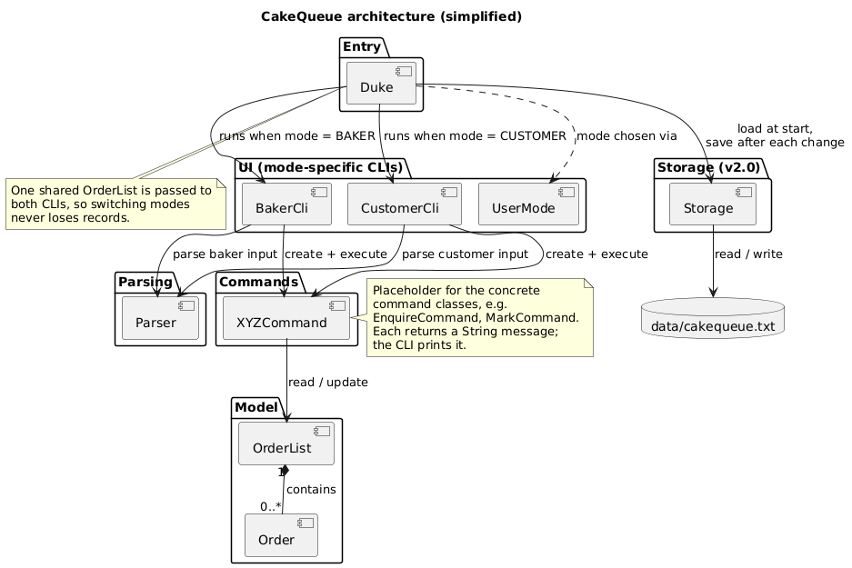
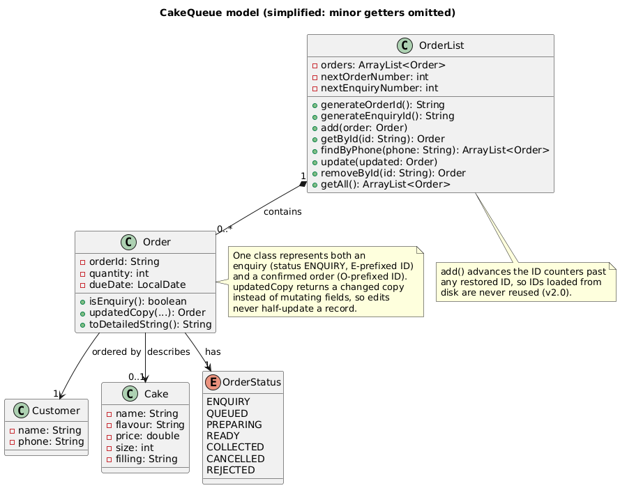
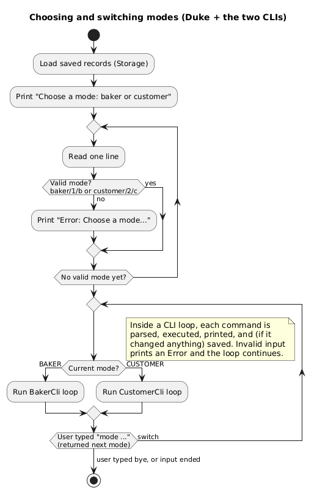
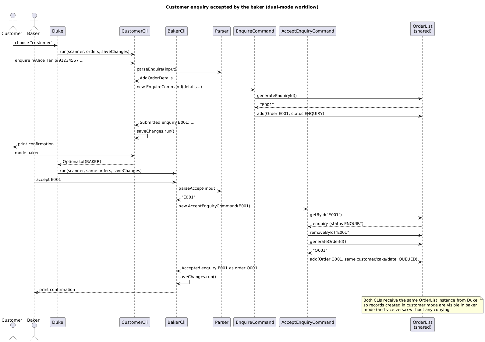
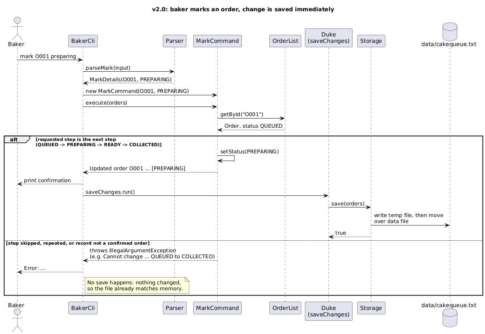
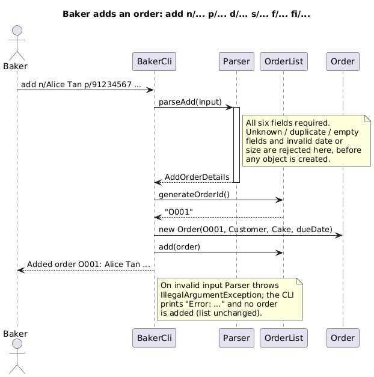
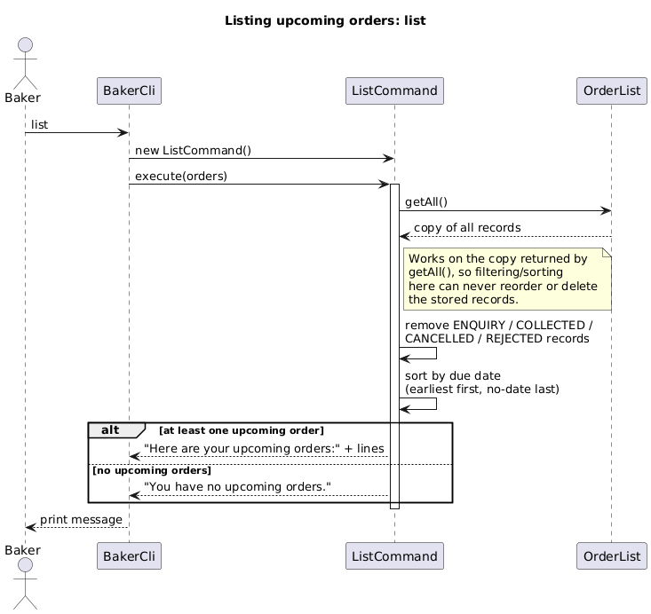
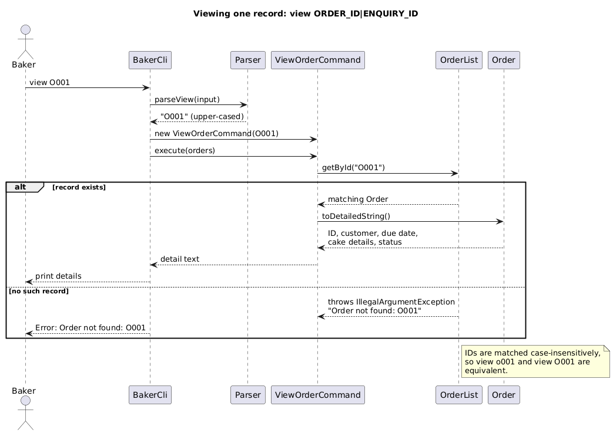
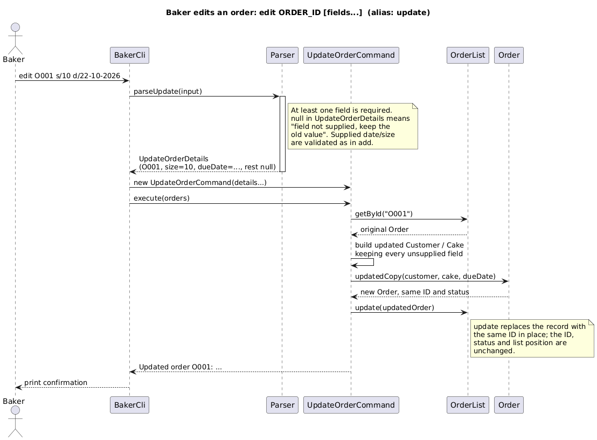

# CakeQueue Developer Guide

## Acknowledgements

* The command-based structure (a parser that validates input, command objects that act on a
  model and return a message for the UI to print) follows the design taught in this course and
  exemplified by AddressBook-Level3 (AB3); no AB3 code is copied into this project.
* Diagrams are written in [PlantUML](https://plantuml.com/) so their sources can be version
  controlled and re-rendered as the design changes.
* Testing uses [JUnit 5](https://junit.org/junit5/), and the build uses Gradle with Checkstyle
  rules adapted from the SE-EDU Java coding standard.

## Setting up in your computer

1. Ensure **Java 25** is installed (`java -version`). On macOS with SDKMAN!:
   `sdk use java 25.0.3.fx-zulu`.
2. Clone this repository and open it as a Gradle project in IntelliJ IDEA.
3. Run `./gradlew test checkstyleMain checkstyleTest` (macOS/Linux) or the `gradlew.bat`
   equivalent on Windows. All tests and style checks should pass.
4. Run the app with `./gradlew run`, or build `build/libs/cakequeue.jar` with
   `./gradlew shadowJar` and run `java -ea -jar build/libs/cakequeue.jar`.
   **Assertions must stay enabled** (`-ea`, and the Gradle `run`/`test` tasks already set
   `enableAssertions = true`) because the code uses `assert` for internal invariants.
5. To re-render the diagrams after editing a `.puml` file in `docs/diagrams/`:
   `java -jar plantuml.jar -Playout=smetana -tpng -o rendered docs/diagrams/*.puml`
   (the `-Playout=smetana` option avoids needing a Graphviz installation).

## Design

### Architecture

  
Source: [`diagrams/ArchitectureDiagram.puml`](diagrams/ArchitectureDiagram.puml)

CakeQueue is a single-process command-line application with five parts:

| Part | Classes | Responsibility |
| --- | --- | --- |
| Entry | `Duke` | Loads saved data, asks for the user mode, runs the right CLI, and supplies the save callback used after every change. |
| UI | `BakerCli`, `CustomerCli`, `UserMode`, `HelpCommand` | Owns the read-eval-print loop for one kind of user. Reads a line, dispatches it, prints the command's returned message, and prints `Error: ...` instead of crashing on bad input. |
| Parser | `Parser` (+ its `*Details` value classes) | Turns raw text into validated, typed values. Throws `IllegalArgumentException` with a user-facing message for anything invalid. Knows nothing about `OrderList`. |
| Commands | `EnquireCommand`, `AcceptEnquiryCommand`, `MarkCommand`, `UpdateOrderCommand`, etc. | One class per user action. `execute(OrderList)` performs the action and **returns** the message to show; commands never print and never read input. |
| Model | `OrderList`, `Order`, `Customer`, `Cake`, `OrderStatus` | Holds records and their invariants (ID generation, lookup by ID/phone, replacement on edit). |
| Storage (v2.0) | `Storage` | Converts between `OrderList` and the plain-text file `data/cakequeue.txt`. |

Three design decisions shape everything else:

1. **One shared `OrderList`.** `Duke` creates a single `OrderList` and passes the same
   instance to both CLIs. Switching modes therefore needs no copying or merging, and a record
   created in customer mode is instantly visible in baker mode.
2. **Commands return `String`, they do not print.** This keeps commands unit-testable without
   capturing `System.out`, and keeps all printing in one place per CLI.
3. **The parser validates before any object exists.** Invalid input fails in `Parser` before
   the model is touched, so a rejected command can never leave a half-added or half-edited
   record behind. The CLI loop catches `IllegalArgumentException`, prints the message, and
   continues; one typo never terminates the app or corrupts data.

### Model

  
Source: [`diagrams/ModelClassDiagram.puml`](diagrams/ModelClassDiagram.puml)

A single `Order` class represents both a customer *enquiry* and a confirmed *order*; the two
are distinguished by `status` (`ENQUIRY` vs. `QUEUED` onwards) and by ID prefix (`E001` vs.
`O001`). We considered a separate `Enquiry` subclass, but almost every field and behaviour
(cake details, due date, editing, cancelling, listing for the owner) is identical, and
accepting an enquiry would then mean converting between types. One class with a status keeps
acceptance to "remove the `E` record, add an `O` record with the same fields", and keeps
`mine`/`track` lookups uniform. The cost — code must check `isEnquiry()` where behaviour
differs — is contained inside the few commands that care.

`Order.updatedCopy(...)` returns a **new** `Order` with the requested fields replaced rather
than mutating the original. Edits therefore build a complete replacement first and swap it in
via `OrderList.update(...)`, so a failed edit cannot leave a record half-updated, and the ID,
status and list position are preserved by construction.

`OrderList.getAll()` returns a defensive copy. Listing commands sort and filter that copy, so
display logic can never accidentally reorder or delete the stored records.

### Record lifecycle

  
Source: [`diagrams/OrderStateDiagram.puml`](diagrams/OrderStateDiagram.puml)

Customers can act only on records still in `ENQUIRY`, and only when the phone number they
supply matches the record — the phone number is our (deliberately lightweight) proof of
ownership; see the alternatives discussion in the dual-mode section below.

---

## Implementation

> **Note for the team (remove before final submission):** the five sections below were drafted
> from the code and Git history so the DG could be peer-reviewed on time. Each named author
> should read, correct and personalise their own section — the explanation of *why* a design
> was chosen must be the author's own.

### Dual-mode interface, enquiry workflow, storage and status marking — Gitanjali (`HammerHead-os`)

  
Source: [`diagrams/ModeActivityDiagram.puml`](diagrams/ModeActivityDiagram.puml)

#### How it is implemented

`Duke.run()` first loads saved records (v2.0, below), then asks
`Parser.parseMode(...)` to turn the first line into a `UserMode` (`baker`/`1`/`b`,
`customer`/`2`/`c`). Invalid answers print an error and the prompt repeats. `Duke` then runs
`BakerCli` or `CustomerCli`; each CLI's loop returns `Optional<UserMode>` — empty for `bye`
(exit the app) or the other mode for `mode customer` / `mode baker`, in which case `Duke`
starts that CLI **with the same `OrderList` and `Scanner`**. Neither CLI can call the other
directly, which keeps the dependency direction one-way (`Duke` → CLIs) and makes each loop
independently understandable.

Each CLI contains one `switch` on the command word. Because the two modes accept *different*
command sets, an action is available in a mode simply by having (or not having) a `case` for
it: `add` in customer mode falls through to a helpful `Unknown customer command` error rather
than being checked with scattered `if (mode == ...)` guards at every command.

The two CLIs share the model but not the commands. A customer submits an enquiry with
`enquire`, which reuses the baker's six-field format; `EnquireCommand` creates an `Order`
with an `E`-prefixed ID and status `ENQUIRY`. `mine` and `track` read records back through
`OrderList.findByPhone(...)` / `getById(...)`, and customer `edit`/`cancel` re-check, inside
the command, that the phone matches and the status is still `ENQUIRY`. Checking inside the
command (not only in the parser) means the rule holds even if a future UI calls the command
directly. The baker reviews with `enquiries`, then `accept` (which removes the `E` record
and adds a fresh `O` record in `QUEUED` with identical customer/cake/date) or `reject`
(status `REJECTED`, record kept so the customer can still see the outcome in `mine`).

#### Why it is implemented this way

* **Two CLI classes, not one CLI with mode flags.** The mode-specific command sets, help
  text and error messages differ in almost every branch; two small classes are easier to
  read and safer to change than one class threaded with mode checks.
* **Phone number as ownership proof, not accounts.** Real logins would need credentials and
  persistent identity — far beyond this product's scope. A phone match is weak security, and
  we document it as such in the User Guide; it is enough to stop *accidental* access (typing
  the wrong ID) and to demonstrate ownership checking. A future version could replace the
  phone check with customer accounts without changing command signatures, because the check
  already lives in exactly one place per command.
* **Accept creates a new ID instead of renaming `E001` to `O001`.** Order IDs are `final` in
  `Order`; minting a new ID keeps IDs immutable (a useful invariant for storage and for
  `getById`) and gives a clean audit story: `E001` was accepted *as* `O001`.

  
Source: [`diagrams/EnquireAcceptSequenceDiagram.puml`](diagrams/EnquireAcceptSequenceDiagram.puml)

#### v2.0 addition 1: persistent storage (`Storage`)

`Duke` owns a `Storage` bound to a `Path` (default `data/cakequeue.txt`; tests inject a
temporary path, which is the only reason the `Duke(Path)` constructor exists). At startup
`Duke` loads the file into the shared `OrderList`. After **every successful mutating
command**, the CLI runs a `Runnable afterChange` callback supplied by `Duke`, which saves.
Passing a callback — rather than giving the CLIs a `Storage` — keeps the CLIs ignorant of
files and keeps the "warn the user if saving failed" policy in one place. Saving immediately,
rather than only on `bye`, means a crash or a closed terminal after a change loses nothing.

The format is one record per line,
`ID | STATUS | NAME | PHONE | DUE | SIZE | FLAVOUR | FILLING`, with `\` and `|` escaped, e.g.:

```text
O001 | PREPARING | Alice Tan | 91234567 | 2026-10-20 | 8 | Chocolate | Strawberry
E001 | ENQUIRY | Bob Lim | 81234567 | 2026-10-21 | 6 | Vanilla | Cream
```

Plain text was chosen over Java serialisation (brittle across class changes, unreadable) and
over adding a JSON library (a dependency and a parser to maintain for eight flat fields), so
the file stays human-readable and hand-repairable. Two defensive measures matter:

* **Corruption tolerance:** a line that does not parse is skipped with a logged warning; one
  bad line cannot prevent the baker from seeing every other order. A missing file is a
  normal first run, not an error.
* **No half-written files:** saving writes to `cakequeue.txt.tmp` and then moves it over the
  real file (atomically where the filesystem supports it), so interrupting a save cannot
  truncate the previous data.

Restoring data creates one subtle bug risk: if the counters restarted at `O001`, new orders
would collide with loaded IDs. `OrderList.add(...)` therefore advances the next-ID counters
past any ID it is given, which maintains the invariant "a generated ID is never already in
use" for both fresh and restored records, with no special case in `Storage`.

#### v2.0 addition 2: production status marking (`mark`)

`OrderStatus` already contained `PREPARING`, `READY` and `COLLECTED`, but until v2.0 nothing
could reach them. `mark ORDER_ID preparing|ready|collected` (baker mode) moves a confirmed
order exactly one step forward. `Parser.parseMark` validates the *shape* (an `O` ID and one
of the three words), while `MarkCommand` validates the *transition* against the order's
current status — shape belongs to the parser, business rules to the command, the same split
used everywhere else. Skipping a step, repeating a step, or marking an enquiry/closed record
is rejected with a message naming the allowed path, and the status is left unchanged
(asserted in tests). `COLLECTED` records disappear from `list` automatically because
`ListCommand` already excluded them.

  
Source: [`diagrams/MarkAndSaveSequenceDiagram.puml`](diagrams/MarkAndSaveSequenceDiagram.puml)

#### Alternatives considered

* **A `done` command that jumps straight to `COLLECTED`** — simpler, but the baker loses the
  "what is in the oven vs. waiting for pickup" distinction, which is the whole point of
  tracking status. Single-step `mark` costs one small transition table.
* **Saving only on exit** — less file I/O, but every abnormal exit loses the session; saving
  after each change is a few lines via the callback and removes that failure mode entirely.
* **One `Cli` class parameterised by `UserMode`** — rejected for the reasons above; it also
  makes mode-aware `help` awkward.

#### Testing

`ModeCliTest` drives whole sessions through `Duke` (mode selection, enquire → accept,
reject, customer cancel, cross-mode rejection of commands, persistence across two launches,
and mark errors). `StorageTest` covers the save/load round trip (including a name containing
`|`), ID continuation after loading, a missing file, and corrupted lines. `MarkCommandTest`
covers every legal step, skipping/repeating, and enquiries. Because tests inject a
`@TempDir` data file, they never touch a developer's real `data/` folder.

### Adding an order (`add`) — Eethan Zhang (`Eethanzyj`)

  
Source: [`diagrams/AddOrderSequenceDiagram.puml`](diagrams/AddOrderSequenceDiagram.puml)

#### How it is implemented

In baker mode, `add n/NAME p/PHONE d/DATE s/SIZE f/FLAVOUR fi/FILLING` is the only way to
create a confirmed order directly. `BakerCli` passes the raw line to
`Parser.parseAdd(...)` (in `Parser`, `parseSixFieldCommand`), which splits the arguments on
the recognised prefixes (`n/`, `p/`, `d/`, `s/`, `f/`, `fi/`). Fields may arrive in any order
and values may contain spaces, because a value runs until the *next* recognised prefix. The
parser rejects unknown prefixes, duplicates, empty values and a missing field; parses the
date strictly as a real `DD-MM-YYYY` date (`ResolverStyle.STRICT`, so `31-02-2026` fails);
and accepts only cake sizes 6, 8 or 10. Only after all of that does `BakerCli` ask
`OrderList` for the next ID, build `Customer` + `Cake` + `Order` (status `QUEUED`), and add
it. (There is no separate `AddOrderCommand` class: the construction needs the fresh ID from
`OrderList`, so `BakerCli.addOrder(...)` performs those three steps and logs the addition.
Extracting an `AddOrderCommand` mirroring `EnquireCommand` is a listed v2.0b cleanup.)

#### Why, and alternatives considered

Validating entirely in the parser means an invalid `add` provably changes nothing — the
integration test adds an invalid order between two valid ones and checks the IDs are still
`O001`, `O002`. A prefix-based format was chosen over positional arguments because values
contain spaces and because the same field machinery is reused by `enquire`, `edit`, `mine`
and `track`; the alternative of splitting on whitespace would make multi-word names and
flavours impossible without quoting rules. The cost is the `fi/` vs. `f/` prefix subtlety,
handled because prefix matching reads the whole token before `/`.

#### Testing

`AddOrderCliTest` (invalid-then-valid session, sequential IDs), `ParserTest` (reordered,
missing, duplicate, unknown fields; invalid date/size), and `OrderListTest` (fields preserved)
cover this feature.

### Listing upcoming orders (`list`) — Kai Sheng (`Kaishhhh`)

  
Source: [`diagrams/ListSequenceDiagram.puml`](diagrams/ListSequenceDiagram.puml)

#### How it is implemented

`ListCommand.execute(orders)` starts from `orders.getAll()`, which returns a **copy** of the
stored records. It removes records that are not actionable upcoming orders — `ENQUIRY`
(those are shown by `enquiries` instead), `COLLECTED`, `CANCELLED` and `REJECTED` — then
sorts by due date, earliest first, with records lacking a due date (legacy in-memory orders)
last; ties keep insertion order because the sort is stable. Display numbers (`1.`, `2.`, ...)
are positions in this listing only; the message and the User Guide direct users to the
stable Order ID for `view`/`edit`/`mark`.

#### Why, and alternatives considered

The original v1.0 `list` only hid `COLLECTED` orders. As enquiries and closed records were
added, showing them in the baker's work list would have buried real work, so the filter grew
— but it grew in the *command*, not in `OrderList`, because "which records exist" (model) and
"which records this view shows" (command) are different questions; `mine`, for example,
deliberately shows a customer their `CANCELLED` records. Filtering a copy rather than the
stored list is essential: an in-place `removeIf` on the real list would delete enquiries
from the system the first time the baker typed `list`. Sorting by due date (rather than
insertion order) matches how a baker plans a day; overdue orders naturally float to the top
because their dates are earliest, with no special overdue logic needed.

#### Testing

`ListCommandTest` covers ordering by due date, same-date stability, the empty message, and
(in the v2.0 suite) that enquiries and closed records are excluded; `ModeCliTest` checks the
integrated listing after an enquiry is accepted.

### Viewing a record (`view`) — Anannya (`anannya-mk`)

  
Source: [`diagrams/ViewSequenceDiagram.puml`](diagrams/ViewSequenceDiagram.puml)

#### How it is implemented

`Parser.parseView(...)` accepts exactly `view` plus one ID matching `[EO][0-9]{3,}` and
upper-cases it, so `view o001` works. `ViewOrderCommand` then returns
`orders.getById(id).toDetailedString()`. `getById` matches IDs case-insensitively and throws
`IllegalArgumentException("Order not found: ...")` for an unknown ID, which the CLI prints
as an error without ending the session. `Order.toDetailedString()` is also the output of the
customer `track` command (after its phone check), and it labels the ID as `Enquiry ID:` or
`Order ID:` according to `isEnquiry()`.

#### Why, and alternatives considered

Lookup by stable ID — not by the position shown in `list` — was a deliberate choice: list
positions change as orders are added, sorted and collected, whereas an ID printed on a
confirmation can be written on a cake box and used hours later. An earlier design used the
1-based index (`OrderList.get(index)` still exists and is tested, but no CLI command uses
it); it was dropped from the UI because "view 2" silently shows a different cake once the
list is re-sorted. Formatting lives in `Order.toDetailedString()` rather than in the command
so baker `view` and customer `track` can never drift into showing different fields.

#### Testing

`DukeTest` covers `getById`/`toDetailedString`; `V1CliTest` covers `view` in lower and upper
case, `view O999`, and malformed `view` input within a recovering session.

### Editing an order (`edit` / `update`) — Will Chin (`WillChin484848`)

  
Source: [`diagrams/EditSequenceDiagram.puml`](diagrams/EditSequenceDiagram.puml)

#### How it is implemented

`edit ORDER_ID [n/...] [p/...] [d/...] [s/...] [f/...] [fi/...]` (alias `update`) requires
at least one field. `Parser.parseUpdate(...)` reuses the update-field extractor
(`parseUpdateFields`), which rejects unknown, duplicate and empty fields, and validates a
supplied date/size exactly as `add` does. Its `UpdateOrderDetails` uses `null` to mean "not
supplied". `UpdateOrderCommand` loads the original, builds a replacement `Customer` and (if
any cake field was supplied) a replacement `Cake`, taking each value from the request when
present and from the original otherwise, rejects the edit if the order has no cake details
to merge into, then calls `original.updatedCopy(...)` and `orders.update(...)`, which swaps
the record with the same ID in place. ID, status and list position are therefore unchanged.

#### Why, and alternatives considered

The null-means-unchanged convention keeps one command class sufficient for every subset of
fields — the alternative, a setter per field called conditionally from the CLI, would mutate
the stored order step by step and could leave it half-edited if a later setter failed; with
`updatedCopy`, the stored record is replaced only once the complete new record exists.
Validating in the parser (before the model is touched) extends the same guarantee to bad
input: `edit O001 s/7` changes nothing. Reusing the `add` validators for supplied fields was
chosen over duplicating them, so the two commands can never disagree about what a legal
date or size is. `update` is kept as an alias because it was the original command word;
accepting both costs one extra `case` label.

#### Testing

`UpdateOrderCommandTest` covers single- and multi-field edits, preservation of unsupplied
fields, and unknown IDs; `ParserTest` covers duplicate/unknown/empty fields and invalid
date/size; `V1CliTest` covers `edit` with tab separators, the `update` alias, and that failed
edits leave the order unchanged.

---

## Product scope

### Target user profile

* A home baker (or very small bakery) taking custom cake orders by phone/message, who is
  comfortable typing commands and wants one reliable list of what to bake, for whom, by when.
* Their customers, who submit and follow up cake enquiries from the same terminal (e.g., an
  in-shop or shared demonstration machine).

### Value proposition

CakeQueue replaces scattered messages and paper notes with one workflow: a customer enquiry
cannot be lost (it sits in `enquiries` until accepted or rejected), nothing is "confirmed"
until the baker accepts it, every confirmed order has a stable ID and a production status,
and everything survives closing the app (v2.0 storage).

### User stories

| Version | As a ... | I want to ... | So that I can ... |
| --- | --- | --- | --- |
| v1.0 | baker | add an order with customer, cake and due date | record a confirmed order in seconds |
| v1.0 | baker | list upcoming orders by due date | plan what to bake first |
| v1.0 | baker | view and edit one order by its ID | check or correct details without ambiguity |
| v1.3 | customer | submit an enquiry and track/edit/cancel it with my phone number | follow up without contacting the baker |
| v1.4 | baker | accept or reject pending enquiries | control which enquiries become real work |
| v2.0 | baker | close and reopen the app without losing records | use CakeQueue across days |
| v2.0 | baker | mark an order preparing, ready, then collected | see production progress at a glance |
| v2.0b (planned) | baker | find records by customer name | answer "did Alice order?" without scanning the list |
| v2.0b (planned) | baker | see orders due today | focus on today's work |

### Non-functional requirements

1. Runs on any OS with Java 25; no installation beyond the JAR, no network access.
2. A typing mistake must never crash the app or change stored data.
3. Saved data must survive an abrupt termination immediately after any accepted change.
4. The data file must be human-readable so a non-programmer can inspect or repair it.
5. Response to every command is effectively instant for a home baker's volume
   (hundreds of records); linear scans are acceptable at this scale.

## Glossary

* **Enquiry** — a customer's request (`E`-prefixed ID, status `ENQUIRY`) that the baker has
  not accepted yet. Not a confirmed order.
* **Order** — a confirmed piece of work (`O`-prefixed ID), created by baker `add` or by
  accepting an enquiry.
* **Record** — an enquiry or an order, when a rule applies to both.
* **Mode** — the baker or customer command interface selected at startup (`UserMode`).

## Tests

Run `./gradlew test checkstyleMain checkstyleTest`. In addition to the per-feature tests
named above, `ParserTest` guards every command's input format and `StorageTest` guards the
file format. Tests use temporary data files and captured standard input/output, so they are
order-independent and never touch a real `data/cakequeue.txt`.

## Instructions for manual testing

1. Build and start: `./gradlew shadowJar`, then `java -ea -jar build/libs/cakequeue.jar`.
   Delete any existing `data/` folder first for a clean start (no "Loaded" message).
2. Type `customer`, then
   `enquire n/Alice Tan p/91234567 d/20-10-2026 s/8 f/Chocolate fi/Strawberry`, then
   `mine p/91234567` and `track E001 p/91234567` (try a wrong phone — it must be rejected).
3. Type `mode baker`, then `enquiries`, `accept E001`, `list`, `mark O001 preparing`,
   `mark O001 collected` (must fail: a step was skipped), `mark O001 ready`,
   `mark O001 collected`, `list` (now empty).
4. Add another order (`add n/Bob Lim p/81234567 d/21-10-2026 s/6 f/Vanilla fi/Cream`), then
   `bye`. Open `data/cakequeue.txt` and check both records are there with their statuses.
5. Restart the app: it should print `Loaded 2 saved record(s).`; choose `baker`, `list`,
   and confirm Bob's order is `O002`-ready work with no ID clash when you add a third order.

## Iteration plan: v2.0 and v2.0b

This is the final planned iteration, so scope was deliberately kept moderate — the team's
priority is a solid, well-tested, well-documented product over extra features.

| Item | Version | Owner (proposed*) | Status |
| --- | --- | --- | --- |
| Persistent storage (`Storage`, save after each change) | v2.0 | Gitanjali | Implemented (this iteration) |
| Production status marking (`mark`) | v2.0 | Gitanjali | Implemented (this iteration) |
| Extract `AddOrderCommand` for symmetry with `EnquireCommand` | v2.0b | Eethan | Planned |
| `find NAME` — search records by customer name (baker) | v2.0b | Kai Sheng | Planned |
| `due today` filter for `list` | v2.0b | Anannya | Planned |
| Reject `edit` on collected/cancelled orders (business-rule check) | v2.0b | Will | Planned |
| User Guide screenshots / final DG and PPP polish | v2.0b | All | Planned |

\* Owners are proposals recorded here for the issue tracker; the team confirms them in
tutorial. Any item that threatens stability may be dropped from v2.0b — dropping a planned
item is preferred over shipping it untested. **Beyond v2.1 (hypothetical):** customer
accounts replacing the phone check, per-day capacity limits with warnings, and a menu with
prices feeding an order total.

## Appendix A: RepoSense authorship

Authorship is marked with `//@@author {GitHub username}` at the top of files written by one
member, and around the large, clearly-owned blocks inside the shared `Parser`
(dual-mode parsing — `HammerHead-os`; `edit` parsing — `WillChin484848`). Genuinely
interleaved files (`Order`, `Cake`, `Customer`, `OrderList`, `ListCommand`, `ParserTest`,
`ListCommandTest`, `DukeTest`) are intentionally left untagged rather than over-claimed;
Git blame attributes their lines. Before each release, every member should open the tP Code
Dashboard, click the `</>` icon next to their name, and check the green lines are theirs
(including AI-assisted code written at their direction), paying attention to these Git
author-name variants so the course team can map them: `anann` → `anannya-mk`,
`Kai Sheng` → `Kaishhhh`, `Will Chin` → `WillChin484848`. Do not tag code generated by the
IDE or taken from elsewhere; reused code would be marked `@@author {user}-reused`.

## Appendix B: Known limitations

* One app instance at a time: two CakeQueue processes sharing one `data/` folder can
  overwrite each other's saves (last writer wins). Acceptable for a single-baker tool.
* The phone number is an ownership *check*, not authentication (see design notes above).
* Orders cannot yet be searched by name, filtered by date, priced, or limited by daily
  capacity (v2.0b / future work, above).
* `Menu`/menu-priced cakes survive from the project's starter code and are not part of the
  CLI workflow; they are retained because early model tests use them.
